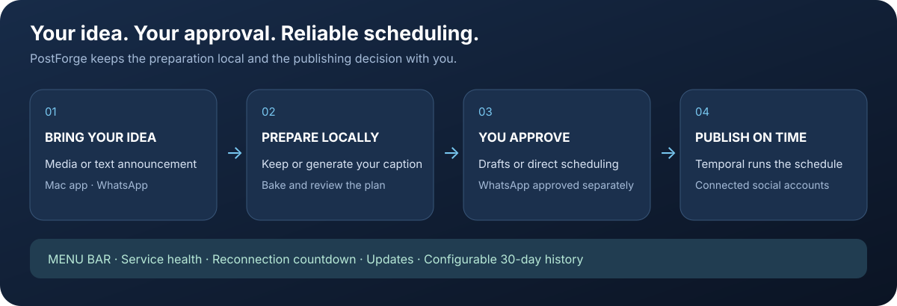
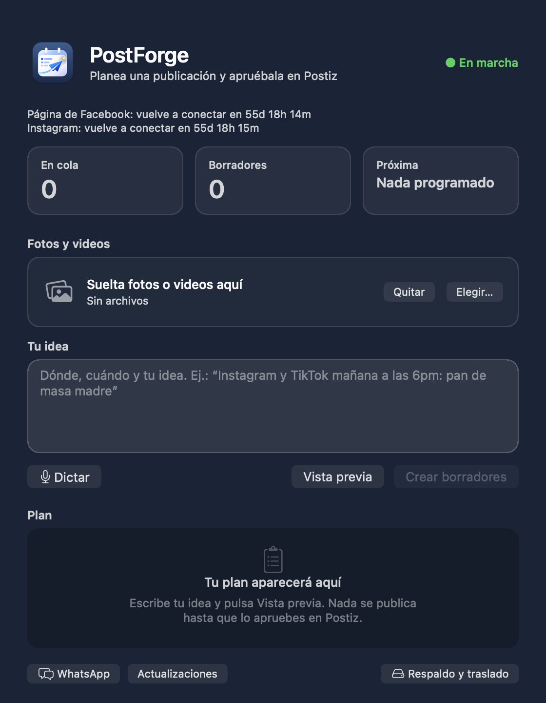
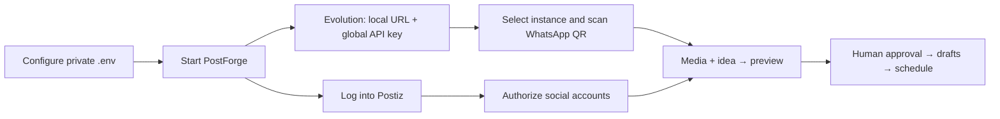
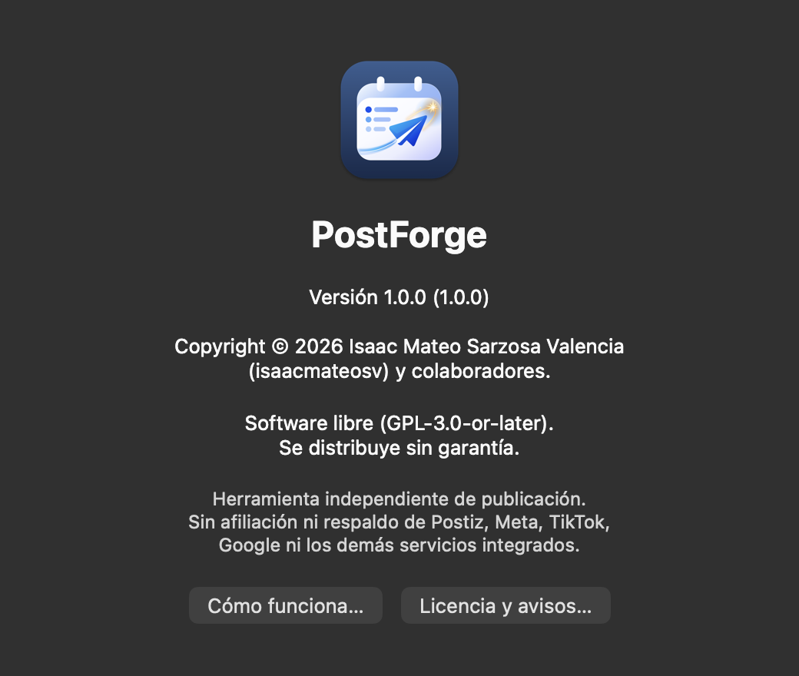

# PostForge

<p align="center"><strong>A human-approved publishing operations center for self-hosted social workflows.</strong></p>

<p align="center"></p>

<p align="center">
  <a href=".github/workflows/validate-and-package.yml"></a>
  <a href="https://github.com/isaacmateosv/postforge/releases"></a>
  <a href="LICENSE"></a>
  
  
</p>

PostForge turns repetitive social-media preparation into a reviewable,
approval-gated workflow. It combines a native macOS app (a menu-bar controller plus a New Post
window), Postiz
drafts and scheduling, local caption generation, WhatsApp self-chat intake,
durable Temporal scheduling, and a guarded maintenance/rollback process.

**Publishing requires human approval:** automated work creates
Postiz **drafts** or waits for an explicit WhatsApp approval. It does not
silently publish content.

> **Project status:** operational on an Apple Silicon Mac; migration and
> distribution remain gated by the validation checklist below. This is a
> self-hosted integration project, not an official client or endorsement of
> any platform.

## Contents

- [What it provides](#what-it-provides)
- [How it works](#how-it-works)
- [Architecture](#architecture)
- [Credentials and first connection](#credentials-and-first-connection)
- [Connections, history, and updates](#connections-history-and-updates)
- [Quick start](#quick-start)
- [Validation and stability](#validation-and-stability)
- [Connection expiry and reconnection](#connection-expiry-and-reconnection)
- [Roadmap](#roadmap)
- [Contributors and acknowledgements](#contributors-and-acknowledgements)
- [License and third-party components](#license-and-third-party-components)

## What it provides

- **Approval-safe drafting:** media and one-sentence instructions become
  reviewable Postiz drafts.
- **WhatsApp self-chat intake:** text, media (up to 32 MiB by default), and optional voice notes become
  plans; approval/rejection commands are explicit and bilingual.
- **Durable scheduling:** Temporal preserves scheduled work across a controlled
  stop/start; late delivery is visible rather than silently discarded.
- **Native app:** a menu-bar controller (lifecycle state, pending work, channel warnings,
  maintenance prompts, tunnel URL editing) and a New Post window for dropping media, writing or
  dictating an idea, previewing the plan, and creating drafts; a WhatsApp window to approve
  or reject plans (with an editable caption) and see Status receipts; and a **Backup & Move**
  window to export, restore or uninstall. English and Ecuadorian Spanish in the native app.
- **Bounded operations:** resource limits, log rotation, 30-day retention,
  health checks, watchdog validation, rollback snapshots, and sanitized release
  packages.

## How it works



1. **Bring media and an idea** through the native Mac window or your WhatsApp self-chat.
2. **Preview locally.** Ollama prepares the caption; check the plan before creating drafts.
3. **Approve in Postiz.** Review the caption, accounts, media, and schedule. WhatsApp plans also require explicit approval.
4. **Let Temporal run the schedule.** Keep the Mac and stack online; the tray shows health, waiting work, and connections that need attention.

Open **PostForge → About PostForge** for the app icon, version/build, copyright and license. **How It Works…** opens this flow; **License & Notices…** displays the bundled legal texts offline. The same About window is accessible from the tray.

<p align="center"></p>

## Credentials and first connection

Start with [SETUP.md](SETUP.md) and copy `.env.example` to a private `.env` (mode `600`). These credentials serve different steps:

| Step | Required credentials or settings | Where they are used |
| --- | --- | --- |
| 1. Local services | `POSTGRES_USER`, `POSTGRES_PASSWORD`, `POSTGRES_DB`; matching `DATABASE_URL`; `REDIS_URL`; a long random `JWT_SECRET` | Docker and Postiz. Keep the JWT secret when migrating to preserve logins. |
| 2. Public HTTPS | `NGROK_AUTHTOKEN`, `NGROK_DOMAIN`; matching `FRONTEND_URL`, `MAIN_URL`, `NEXT_PUBLIC_BACKEND_URL` | Tunnel and OAuth callbacks. Use **Tunnel URL…** to change related URLs together. |
| 3. Postiz account | Your own Postiz email/password, created on first setup | Log in to the Postiz calendar. This is separate from the Evolution API key. Keep public registration disabled afterward. |
| 4. WhatsApp Manager | Local server URL `http://localhost:8080`, **global API key** = `AUTHENTICATION_API_KEY`; instance = `WA_INSTANCE` | Open **WhatsApp Manager** from the tray. There is no separate Evolution username/password in this deployment. Never put the key in a URL or screenshot. |
| 5. Link WhatsApp | Access to the intended phone's WhatsApp **Linked devices** screen | Scan the QR for that instance. `./scripts/link-whatsapp.sh` creates a missing instance and refreshes the QR; it leaves a working session untouched. Re-link on a new Mac. |
| 6. Social accounts | Account access plus provider developer-app IDs/secrets for the channels you enable | Connect each channel inside Postiz. See [app keys](docs/reconnect/app-keys.md), [Meta](docs/reconnect/meta.md), [TikTok](docs/reconnect/tiktok.md), [YouTube](docs/reconnect/youtube.md), and [Threads](docs/reconnect/threads.md). |
| 7. Local captions | Installed Ollama and `LOCAL_LLM_MODEL` | No cloud API key is needed for local captions. Gemini is optional and disabled unless explicitly enabled. |
| Backup and migration | A passphrase of at least 12 characters | Encrypts the exported credentials; it is separate from all service passwords. |

**Large WhatsApp files:** intake checks the protobuf file size before asking Evolution to download/base64-encode media. The default is 32 MiB (`WA_MAX_MEDIA_MB`, effective range 1–64 MiB). Unknown sizes are rejected. Send larger videos through the Mac window, which avoids the Evolution base64 memory overhead.

The host scripts obtain the Postiz organization's API key from the local database; this setup does not require a separate `POSTIZ_API_KEY` environment variable. Never reuse the Evolution global key as a Postiz password.



## Connections, history, and updates

- **Language:** choose **Settings & Tools → Language → Español (Ecuador)**. Open windows and the app menu update without discarding the idea or selected media. Dates use `es_EC`; captions, operator content, and raw upstream errors keep their original text. Postiz and Evolution have their own language controls.
- **Reconnection timer:** the tray and main window show days, hours, and minutes until the next nonrenewable social token expires. The tray lists every affected connection. Facebook and Instagram require reconnection; renewable channels show that they renew automatically. This is a social-channel token timer, separate from the Postiz web login. Dates saved while offline are labeled as cached; no precise expiry is invented for WhatsApp or an unknown token. The display refreshes with the existing status poll, about once a minute while on.
- **Saved history defaults to 30 days.** Change it through **Settings & Tools → Maintenance → Saved History…** (`PM_RETENTION_DAYS`). The age applies to logs and unused uploaded media. Review `./postforge.sh retention` before applying `./postforge.sh retention --apply`; changing the setting alone deletes nothing. Pending plans, referenced media, databases, credentials, and backups are preserved. If Postiz cannot be checked, uploads are retained. `--days N` overrides the setting for one cleanup.
- **App updates:** stable GitHub releases are checked on launch and every six hours. Installation is an explicit action. PostForge downloads the package, verifies its published SHA-256 checksum, and invokes the macOS installer, which may request administrator authentication. Runtime data is retained. Prereleases are excluded. Both the main window's **Updates** button and the tray show explicit app/component results, hide the progress bar when finished, and offer **Done**, **Try Again**, or a direct update action. App and component checks run concurrently with bounded timeouts.
- **Component updates:** checks compare local Docker image digests with the declared tags, separately from Homebrew. Approved updates save code and local image IDs, download before stopping services, restart, and run the live watchdog. Progress shows each stage and reports failure. A rollback restores code and image tags; it does not reverse database migrations. New upstream version tags require a reviewed release/configuration change.

## Architecture

```text
PostForge.app (menu bar + New Post window)
        │
        ├── postforge.sh ── Docker Compose ── Postiz ── Temporal
        │                                      ├── PostgreSQL
        │                                      └── Redis (AOF)
        ├── WhatsApp self-chat worker ── Evolution API
        ├── Ollama (local captions; idle models evicted)
        └── ngrok/custom HTTPS tunnel
```

The project’s orchestration code is original to this repository. Postiz,
Evolution API, Temporal, PostgreSQL, Redis, Ollama, ngrok, Baileys, and social
platform APIs are external components with their own licenses, terms, and
operational constraints. See [NOTICE.md](NOTICE.md) and [AUTHORS.md](AUTHORS.md).

## Quick start

Download the latest **PostForge-<version>.pkg** and its checksum from [GitHub Releases](https://github.com/isaacmateosv/postforge/releases/latest). The installer supports macOS 13+ on Apple silicon and Intel. It preserves private data on upgrades. The app is ad-hoc signed; the installer is unsigned and not Apple notarized. See [SETUP.md](SETUP.md) for first-open instructions.


```bash
./install.sh --check
./scripts/recheck.sh
./postforge.sh doctor
./postforge.sh start
./scripts/recheck.sh --live
./postforge.sh status
```

`./postforge.sh` is the canonical command name; `./publish-machine.sh` remains as a legacy compatibility wrapper.

For a new Mac, follow [SETUP.md](SETUP.md). Keep `.env`, exports, databases,
logs, media, and WhatsApp session state private; they are intentionally absent
from release packages.

### Easy migration

In the PostForge app, open **Backup & Move…** (menu bar → Settings & Tools → Maintenance, the app menu, or the
button at the bottom of the New Post window). Choose a folder, enter a passphrase of at least 12 characters, and press
**Export Backup**. PostForge creates a private `PostForge-migration-…` folder with the encrypted credentials, the Postiz
data and the installer, and shows its progress. Copy that folder privately to the new Mac, double-click the `.pkg`,
open PostForge there and use **Backup & Move → Restore**. From a terminal the same flow is:

```bash
./scripts/migrate.sh export            # old Mac (asks for the passphrase in the terminal)
./scripts/migrate.sh import ~/Desktop/PostForge-migration-YYYYMMDD-HHMM   # new Mac, after installing the .pkg
```

The handoff never copies WhatsApp session state; link WhatsApp again by QR on the new Mac. The passphrase
cannot be recovered: without it the backup cannot be restored.

## Validation and stability

Before creating or publishing a release:

```bash
./scripts/recheck.sh          # static and package-boundary checks
./scripts/recheck.sh --live   # runtime watchdog; requires the stack online
./postforge.sh doctor
./postforge.sh maintenance check
./scripts/package.sh  # creates a macOS PostForge-*.pkg installer
```

The live watchdog must report:

```text
Watchdog: PASS
state=on postiz=ok evolution=ok scheduler=ok whatsapp=open tunnel=ok
```

GitHub Actions run the static recheck and build the tray app on pushes and pull
requests. A sanitized package is generated only for `v*` tags or a manually
dispatched workflow. GitHub Actions never receive `.env`, runtime databases,
WhatsApp sessions, logs, media, or private exports.

## Connection expiry and reconnection

Automatic renewal is a capability, not a promise of permanent access. PostForge monitors the
installed Postiz integration, reports recorded expiry dates, and alerts when a channel needs attention.

| Connection | Renewal in this Postiz build | When you may need to reconnect |
| --- | --- | --- |
| Facebook Page | No working provider refresh method | Before its recorded expiry, or after permissions/account access change. |
| Instagram via Facebook Login | No working provider refresh method | Before its recorded expiry; reconnect both Meta channels when their dates coincide. |
| Threads | Automatic refresh supported | If the token expires before renewal, permissions are revoked, app keys change, or renewal fails. |
| TikTok | Automatic refresh supported; returned refresh tokens are stored | If refresh credentials expire/revoke, sandbox target access is removed, keys change, or switching sandbox/production credentials. |
| YouTube | Automatic refresh supported | Revoked/expired refresh credentials, prolonged disuse, account policy changes, or OAuth Testing restrictions. External Google OAuth apps in Testing generally issue refresh credentials that expire after seven days. |
| WhatsApp via Evolution | Linked-device session, not a scheduled OAuth renewal | Unlinking, phone/device inactivity or a provider session reset; scan a fresh QR. |
| Postiz web login | Separate local signed session | Sign in again when the browser session expires or the signing secret changes. This is separate from social-channel tokens. |
| Tunnel and service credentials | Configuration/credential health | Rotated/revoked ngrok or developer credentials, a changed domain, or local service failures. |

**TikTok preview/sandbox is not production approval.** Only configured target users can use a sandbox;
TikTok states that sandbox mode does not provide public-video posting. Unaudited Direct Post also
has private-viewing restrictions. The default `UPLOAD` path sends content to the TikTok inbox for
an explicit finishing action; account authorization does not guarantee posting eligibility or publication.
Token validity and app-review status are separate checks. Token lifetimes must come from actual
provider responses; do not assume a permanent connection or a universal one-year refresh period.

See the provider guides in [docs/reconnect](docs/reconnect/README.md).
Authoritative references: [Google OAuth expiry](https://developers.google.com/identity/protocols/oauth2#expiration),
[TikTok tokens](https://developers.tiktok.com/docs/en/oauth-refresh-a-user-access-token),
[TikTok sandbox](https://developers.tiktok.com/docs/en/add-a-sandbox),
[TikTok publishing restrictions](https://developers.tiktok.com/docs/en/content-sharing-guidelines), and
[WhatsApp linked devices](https://faq.whatsapp.com/378279804439436/).

## Roadmap

**Release 1 (`v1.0.x`)** provides the publishing foundation described here.
**Release 2 (`v2.0.0`)** will add Telegram connection setup, health-aware pings and alerts.
Telegram code, credentials and background requests are excluded from release 1.
See [ROADMAP.md](ROADMAP.md).

## Contributors and acknowledgements

**Isaac Mateo Sarzosa Valencia** ([`isaacmateosv`](https://github.com/isaacmateosv)) is the
human orchestrator and release owner. Development and review were assisted by **GitHub Copilot
using Copilot SDK in VS Code**, **Anthropic Claude**, and **OpenAI Codex**. These AI systems are
credited as development assistants; they are not GitHub contributor accounts, legal authors,
copyright holders or maintainers. GitHub's Contributors panel reflects commit authorship.

## License and third-party components

<p align="center"></p>

PostForge's original code and app are free software under the GNU GPL v3.0 or later ([LICENSE](LICENSE), [copyright notice](COPYRIGHT)). You may use, study, modify and redistribute them under those terms; distributed covered binaries must be accompanied by Corresponding Source as required by the GPL. Provided without warranty. Postiz, Evolution API, Baileys, Temporal,
PostgreSQL, Redis, Ollama, whisper.cpp, ngrok and platform APIs retain their own terms and licenses.
See [LICENSE](LICENSE), [COPYRIGHT](COPYRIGHT), [AUTHORS.md](AUTHORS.md), [NOTICE.md](NOTICE.md), and [SECURITY.md](SECURITY.md).

The app is ad-hoc signed; the installer is unsigned and not Apple notarized. The project is provided
as-is, without a guarantee of third-party availability or approval. Provider credentials and a working
login do not make an integration official. Use platform integrations only where permitted.
