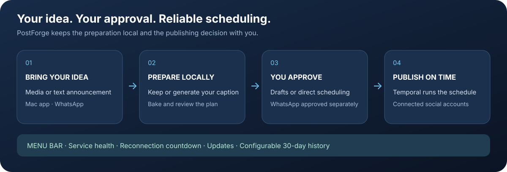
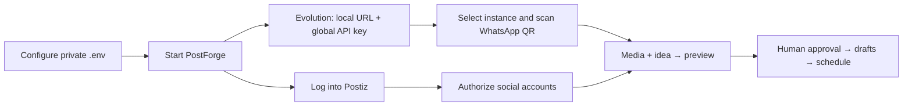
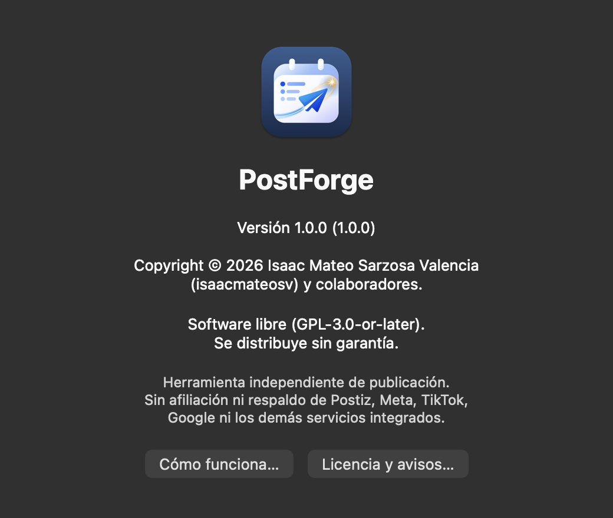

# PostForge

<p align="center"><strong>A human-approved publishing operations center for self-hosted social workflows.</strong></p>

<p align="center"></p>

<p align="center">
  <a href=".github/workflows/validate-and-package.yml"></a>
  <a href="https://github.com/isaacmateosv/postforge/releases"></a>
  <a href="LICENSE"></a>
  
  
</p>

PostForge turns repetitive social-media preparation into a reviewable,
approval-gated workflow. It combines a Rust/Tauri desktop app with a system tray and structured publishing window, Postiz
drafts and scheduling, local caption generation, WhatsApp self-chat intake,
durable Temporal scheduling, and a guarded maintenance/rollback process.

**Publishing requires human approval:** create Postiz drafts for later approval,
or explicitly confirm **Schedule directly** in the Rust desktop app to approve
all selected destinations, including WhatsApp Status, at the reviewed time.

> **Project status:** operational on an Apple Silicon Mac; migration and
> distribution remain gated by the validation checklist below. This is a
> self-hosted integration project, not an official client or endorsement of
> any platform.

## Current v2 development

**Rust/Tauri is the desktop client going forward.** Use the [Rust desktop guide](desktop/README.md)
for the current preview. The Swift controller is retained as legacy source for
compatibility and reference, rather than a second app to run alongside Rust.
Installation paths stay inside advanced recovery; WhatsApp pairs by QR in the window. Some system integrations are still being ported; this is a beta, not a feature-complete
replacement release. Current desktop releases include a Rust macOS `.pkg` and platform ZIPs with their public backend code bundled.

## Contents

- [What it provides](#what-it-provides)
- [How it works](#how-it-works)
- [Architecture](#architecture)
- [Credentials and first connection](#credentials-and-first-connection)
- [Connections, history, and updates](#connections-history-and-updates)
- [Quick start](#quick-start)
- [Validation and stability](#validation-and-stability)
- [Connection expiry and reconnection](#connection-expiry-and-reconnection)
- [Roadmap](#roadmap)
- [Contributors and acknowledgements](#contributors-and-acknowledgements)
- [License and third-party components](#license-and-third-party-components)

## User guides

| Guide | English | Español (Ecuador) |
| --- | --- | --- |
| Quick start | [Start here](docs/help/quick-en.md) | [Inicio rápido](docs/help/quick-es.md) |
| Technical | [Setup and operation](docs/help/technical-en.md) | [Instalación y operación](docs/help/technical-es.md) |

Open **Help** in the desktop app to read either guide offline in the selected app language.

## What it provides

- **Approval-safe drafting:** media and one-sentence instructions become
  reviewable Postiz drafts.
- **WhatsApp self-chat intake:** text, photos, videos up to 256 MiB, and optional voice notes become
  plans; approval/rejection commands are explicit and bilingual.
- **Durable scheduling:** Temporal preserves scheduled work across a controlled
  stop/start; late delivery is visible rather than silently discarded.
- **Rust desktop and tray:** a live dashboard, Compose → Delivery → Review workflow,
  media/cover previews, caption versions and separate YouTube title editing. Settings
  include WhatsApp QR/audience, Telegram, service controls, backups, requirements,
  network access and portable defaults. English and Ecuadorian Spanish throughout.
- **Bounded operations:** resource limits, log rotation, 30-day retention,
  health checks, watchdog validation, rollback snapshots, and sanitized release
  packages.

## Rust desktop and Telegram

The Rust/Tauri client opens on a live draft/schedule dashboard and has structured Compose, Delivery and Review steps
and shares the existing Python planner. See the [desktop setup guide](desktop/README.md).
The legacy Swift source documents the system integrations still being ported.
Native builds run on macOS, Windows and Linux in CI; installation and real-device
acceptance remain separate release checks.

The private Telegram bot now guides caption mode, media, destinations, formats,
time, cover/tag options, revisions and final confirmation through buttons.
Each installation supplies its own bot; there is no shared global bot. Open
**Telegram** in the Rust app header to validate its token, select the private
owner and configure language, heartbeat and activation. Settings travel in the
encrypted credentials backup; migration restores Telegram paused until explicit
activation on the destination. Full bilingual instructions are in Help.

## How it works



1. **Bring media and an idea** through the desktop window or your WhatsApp self-chat.
2. **Bake idea locally.** Ollama prepares the caption; check the plan before creating drafts.
3. **Review and approve.** Create drafts for later approval in Postiz (with a separate WhatsApp approval), or confirm **Schedule directly** to approve every selected destination. Edit the date/time in step 3 without regenerating your caption.
4. **Let Temporal run the schedule.** Keep the Mac and stack online; the tray shows health, waiting work, and connections that need attention.

The Mac composer uses two columns, with media and the request beside the scrollable
plan. Bake with **⌘ Return**, review the resolved time and destinations, and then
use **Create Drafts** or confirm **Schedule directly**. **Try Another Caption**,
**Edit Caption…**, and the **‹ / ›** version controls update the copy section.
Changing scheduling inputs requires a fresh bake. Use **idea:** with an unquoted
brief to generate copy, or **caption:** and double quotes to preserve your wording.

With no media, the app asks which supported text destinations should receive the
announcement. **Clear…** previews and confirms cleanup of drafts, failed entries,
queued posts and pending WhatsApp Status. Work already sending may finish.
The current workflows and limitations are described in the
[English quick guide](docs/help/quick-en.md),
[guía rápida en español de Ecuador](docs/help/quick-es.md),
[English technical guide](docs/help/technical-en.md), and
[guía técnica en español](docs/help/technical-es.md).

Open **About PostForge** near the end of the tray for version, concept, copyright and GPL notice. The packaged app includes full license and third-party notices; Help includes the operational flow and offline guides.


## Credentials and first connection

Start with [SETUP.md](SETUP.md) and copy `.env.example` to a private `.env` (mode `600`). These credentials serve different steps:

| Step | Required credentials or settings | Where they are used |
| --- | --- | --- |
| 1. Local services | `POSTGRES_USER`, `POSTGRES_PASSWORD`, `POSTGRES_DB`; matching `DATABASE_URL`; `REDIS_URL`; a long random `JWT_SECRET` | Docker and Postiz. Keep the JWT secret when migrating to preserve logins. |
| 2. Protected HTTPS | Selected TryCloudflare, named Cloudflare or saved ngrok profile; matching public origins; gateway users and authenticator enrollment | **Manage Postiz link** synchronizes the origin. Provider console callbacks are updated separately when reconnection requires it. |
| 3. Postiz account | Your own Postiz email/password, created on first setup | Log in to the Postiz calendar. This is separate from the Evolution API key. Keep public registration disabled afterward. |
| 4. WhatsApp Manager | Local server URL `http://localhost:8080`, **global API key** = `AUTHENTICATION_API_KEY`; instance = `WA_INSTANCE` | Use the in-window WhatsApp QR flow; the local Evolution manager is an advanced tool. There is no separate Evolution username/password in this deployment. Never put the key in a URL or screenshot. |
| 5. Link WhatsApp | Access to the intended phone's WhatsApp **Linked devices** screen | Scan the QR for that instance. `./scripts/link-whatsapp.sh` creates a missing instance and refreshes the QR; it leaves a working session untouched. Re-link on a new Mac. |
| 6. Social accounts | Account access plus provider developer-app IDs/secrets for the channels you enable | Connect each channel inside Postiz. Start with [first-time setup and permissions](docs/reconnect/channel-setup.md), then see [app keys](docs/reconnect/app-keys.md), [Meta](docs/reconnect/meta.md), [TikTok](docs/reconnect/tiktok.md), [YouTube](docs/reconnect/youtube.md), and [Threads](docs/reconnect/threads.md). |
| 7. Local captions | Installed Ollama and `LOCAL_LLM_MODEL` | No cloud API key is needed for local captions. Gemini is disabled; the normal workflow uses only local generation. |
| Backup and migration | A passphrase of at least 12 characters | Encrypts and authenticates the exported data and credentials; it is separate from all service passwords. |

**Large WhatsApp files:** PostForge streams videos above the regular intake limit to disk, up to 256 MiB, and verifies the file size and SHA-256 before using them. The regular intake limit is 32 MiB by default (`WA_MAX_MEDIA_MB`, effective range 1–64 MiB). Use New Post for bigger files or media with missing download metadata.

The host scripts obtain the Postiz organization's API key from the local database; this setup does not require a separate `POSTIZ_API_KEY` environment variable. Never reuse the Evolution global key as a Postiz password.



The composer keeps its next-step buttons visible below the scrolling form. Cover previews confirm success explicitly; direct scheduling offers an eight-second, cancellable return to Dashboard. Telegram provides **Settings · activity ping** (`/settings`). WhatsApp settings require explicit commands or a deliberate Settings-button tap: `postforge settings`, `postforge ping 60`, or `postforge ping off`; captions never trigger a settings mode. Ping preferences travel in encrypted backups and do not start stopped services.

WhatsApp self-chat plans also offer reply buttons for approval review, caption revision and plan options. Final approval is a separate confirmation; buttons refer to the exact reviewed plan and expire after use. Copyable text commands remain available as a fallback. The pinned Evolution service receives a targeted rendering compatibility patch at every boot.

## Connections, history, and updates

- **Language:** Settings offers English or Español (Ecuador); Postiz and Evolution have independent language controls.
- **Connections:** token validity comes from Postiz, not an invented countdown. Renewable expired tokens can renew on use; Check & renew verifies through supported read-only calls. Reconnect only the affected account when required. Green credentials do not guarantee public media access or publishing success.
- **Retention:** 30 days by default, configurable in Settings/tray. Pending plans and non-deleted Postiz posts protect referenced media. Automatic WhatsApp cleanup includes both message and Status staging. Expiring logs does not reset approval IDs or erase all saved posts.
- **Updates:** checked at startup/every six hours, with a tray marker. Manual checks inspect components too. macOS installs a verified matching client/runtime and refreshes configured services; Windows/Linux stage an archive for manual replacement. Backup/publishing tasks block conflicting installation. A newer Evolution image requires tested compatibility, not blind replacement.
- **Backups:** use the dedicated assistant to export, inspect and restore an encrypted `.pfbackup`. Reopen live work or Resume progress after bridge errors without starting another restore. Migration pauses services and Telegram for destination validation.
- **Resources:** local models unload after caption requests. Explicit service controls preserve shared tools and block stopping queued work. Rust automatic OS wake/idle shutdown remains future work.

## Architecture

```text
PostForge Desktop (Rust/Tauri + system tray)
        │
        ├── shared Python runtime ── Docker Compose ── Postiz ── Temporal
        │                                      ├── PostgreSQL
        │                                      └── Redis (AOF)
        ├── WhatsApp self-chat worker ── Evolution API
        ├── Ollama (local captions; idle models evicted)
        └── HTTPS tunnel ── Caddy/Authelia gateway
```

The project’s orchestration code is original to this repository. Postiz,
Evolution API, Temporal, PostgreSQL, Redis, Ollama, ngrok, Baileys, and social
platform APIs are external components with their own licenses, terms, and
operational constraints. See [NOTICE.md](NOTICE.md) and [AUTHORS.md](AUTHORS.md).

## Quick start

Install the matching [release artifact](https://github.com/isaacmateosv/postforge/releases): macOS ARM64 `.pkg`/ZIP, Linux x86_64 ZIP or Windows x86_64 ZIP. The public backend is bundled; credentials and models are not. Open **Settings → Check requirements**, then use **Restore backup** for migration or follow [SETUP.md](SETUP.md) for fresh configuration. Normal use does not require selecting a project folder.

On Dashboard choose **New post**: compose, select delivery, bake/review, then create drafts or explicitly confirm direct scheduling. TikTok Inbox Upload requires finishing in TikTok; the app provides a caption-copy handoff. See the bilingual guides above for the complete workflow.

Service controls stop only this installation after confirming its scheduled queue is empty. The Rust client does not yet reproduce Swift's automatic sleep/wake controller. Keep the host awake for scheduled delivery. Retention defaults to 30 days for unused local files/history; referenced Postiz media remains protected and approval identifiers do not reset.

## Validation and stability

Before creating or publishing a release:

```bash
./scripts/recheck.sh          # static and package-boundary checks
./scripts/recheck.sh --live   # runtime watchdog; requires the stack online
./postforge.sh doctor
./postforge.sh maintenance check
cargo build --release --locked --manifest-path desktop/Cargo.toml
python3 desktop/package.py --no-build  # current Rust archives and macOS PKG
```

The live watchdog must report:

```text
Watchdog: PASS
state=on postiz=ok evolution=ok scheduler=ok whatsapp=open tunnel=ok
```

GitHub Actions run static and runtime regression checks and build the Rust client on
macOS, Windows and Linux. Tagged releases publish matching sanitized artifacts. GitHub Actions never receive `.env`, runtime databases,
WhatsApp sessions, logs, media, or private exports.

## Connection expiry and reconnection

Automatic renewal is a capability, not a promise of permanent access. PostForge monitors the
installed Postiz integration, reports recorded expiry dates, and alerts when a channel needs attention.

| Connection | Renewal in this Postiz build | When you may need to reconnect |
| --- | --- | --- |
| Facebook Page | No working provider refresh method | Before its recorded expiry, or after permissions/account access change. |
| Instagram via Facebook Login | No working provider refresh method | Before its recorded expiry; reconnect both Meta channels when their dates coincide. |
| Threads | Automatic refresh supported | If the token expires before renewal, permissions are revoked, app keys change, or renewal fails. |
| TikTok | Automatic refresh supported; returned refresh tokens are stored | If refresh credentials expire/revoke, sandbox target access is removed, keys change, or switching sandbox/production credentials. |
| YouTube | Automatic refresh supported | Revoked/expired refresh credentials, prolonged disuse, account policy changes, or OAuth Testing restrictions. External Google OAuth apps in Testing generally issue refresh credentials that expire after seven days. |
| WhatsApp via Evolution | Linked-device session, not a scheduled OAuth renewal | Unlinking, phone/device inactivity or a provider session reset; scan a fresh QR. |
| Postiz web login | Separate local signed session | Sign in again when the browser session expires or the signing secret changes. This is separate from social-channel tokens. |
| Tunnel and service credentials | Configuration/credential health | Rotated/revoked ngrok or developer credentials, a changed domain, or local service failures. |

**TikTok preview/sandbox is not production approval.** Only configured target users can use a sandbox;
TikTok states that sandbox mode does not provide public-video posting. Unaudited Direct Post also
has private-viewing restrictions. The default `UPLOAD` path sends content to the TikTok inbox for
an explicit finishing action; account authorization does not guarantee posting eligibility or publication.
Token validity and app-review status are separate checks. Token lifetimes must come from actual
provider responses; do not assume a permanent connection or a universal one-year refresh period.

See the provider guides in [docs/reconnect](docs/reconnect/README.md).
Authoritative references: [Google OAuth expiry](https://developers.google.com/identity/protocols/oauth2#expiration),
[TikTok tokens](https://developers.tiktok.com/docs/en/oauth-refresh-a-user-access-token),
[TikTok sandbox](https://developers.tiktok.com/docs/en/add-a-sandbox),
[TikTok publishing restrictions](https://developers.tiktok.com/docs/en/content-sharing-guidelines), and
[WhatsApp linked devices](https://faq.whatsapp.com/378279804439436/).

## Roadmap

**Release 1 (`v1.0.x`)** provides the publishing foundation described here.
**Release 2 (`v2.0.0`)** adds a local browser dashboard, a separate MFA gateway for optional remote access, and private Telegram guided posting, status and heartbeat. See the [v2 release candidate guide](v2/README.md) for setup and acceptance checks.
Telegram code, credentials and background requests are excluded from release 1.
See [ROADMAP.md](ROADMAP.md).

## Contributors and acknowledgements

**Isaac Mateo Sarzosa Valencia** ([`isaacmateosv`](https://github.com/isaacmateosv)) is the
human orchestrator and release owner. Development and review were assisted by **GitHub Copilot
using Copilot SDK in VS Code**, **Anthropic Claude**, and **OpenAI Codex**. These AI systems are
credited as development assistants; they are not GitHub contributor accounts, legal authors,
copyright holders or maintainers. GitHub's Contributors panel reflects commit authorship.

## License and third-party components

<p align="center"></p>

PostForge's original code and app are free software under the GNU GPL v3.0 or later ([LICENSE](LICENSE), [copyright notice](COPYRIGHT)). You may use, study, modify and redistribute them under those terms; distributed covered binaries must be accompanied by Corresponding Source as required by the GPL. Provided without warranty. Postiz, Evolution API, Baileys, Temporal,
PostgreSQL, Redis, Ollama, whisper.cpp, ngrok and platform APIs retain their own terms and licenses.
See [LICENSE](LICENSE), [COPYRIGHT](COPYRIGHT), [AUTHORS.md](AUTHORS.md), [NOTICE.md](NOTICE.md), and [SECURITY.md](SECURITY.md).

The app is ad-hoc signed; the installer is unsigned and not Apple notarized. The project is provided
as-is, without a guarantee of third-party availability or approval. Provider credentials and a working
login do not make an integration official. Use platform integrations only where permitted.


### Public access providers

Use **Settings → Public access** or **Postiz Link & Access** in the Rust menu bar to switch between temporary TryCloudflare, a named Cloudflare tunnel with your own domain, and saved ngrok. Gateway authentication stays enabled. URL changes synchronize Postiz and its media origins, but developer-console OAuth callbacks require manual updates. Temporary URLs change on connector restart and are intended for testing. Provider preferences and secrets are included in encrypted migrations. [English setup](docs/reconnect/public-address.md) · [Guía en español](docs/reconnect/public-address-es.md).

To import a `.pfbackup`, use **Settings → App & data → Restore backup → Choose backup file**, then inspect it with its passphrase. The advanced installation-folder chooser is only for locating an existing installation. Backups include retained videos and can be large. See the in-app bilingual Help for the destination-host restore checklist.

The access screen separates the Postiz link, the two browser logins, and social-account authorization. Use **Use detected link** only when a changed address is detected; keep working social accounts connected. Account-specific reconnect buttons show the matching callback and next steps. Domain changes and requesting another random address are under Advanced. See the [English access guide](docs/reconnect/public-address.md) or [guía en español](docs/reconnect/public-address-es.md).
