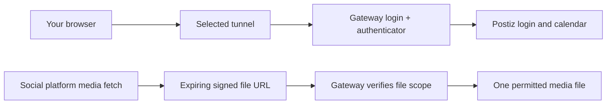

# PostForge Technical Guide

Current v2 development uses the Rust desktop client. Earlier Mac-controller sections describe legacy Swift behavior and are not Rust feature claims. See Rust and Telegram implementation below for the current beta scope.

PostForge is a local macOS controller for a self-hosted publishing stack. It prepares plans and drafts. Postiz and Temporal handle approved social schedules. Evolution and Baileys link the operator’s WhatsApp session.

```text
Mac composer ───────────────┐
WhatsApp → Evolution ───────┼→ Planner → Preview and approval
Local Ollama captions ──────┘                │
                                             ├→ Postiz → Temporal → Social channels
                                             └→ Approved Status queue → Evolution
```

## Install and configure

1. Install the PostForge package and the prerequisites listed in SETUP.md, including Docker Desktop, Ollama, and FFmpeg.
2. Copy .env.example to .env. Set the database credentials and JWT secret, the ngrok domain and token, and the Evolution API key. Set the project time zone with PM_TIMEZONE if you operate outside Ecuador.
3. Choose local access or an authenticated HTTPS gateway. Configure provider OAuth credentials and callback URLs for the selected Postiz origin, then connect the social accounts in Postiz. The repository’s [channel setup guide](https://github.com/isaacmateosv/postforge/blob/main/docs/reconnect/channel-setup.md) lists the scopes for each connector.
4. Turn on PostForge. Open **WhatsApp Manager**, then use the authorized phone to scan its QR code. Keep its API key private.
5. Run the read-only health checks from the project directory.

```bash
cd ~/postforge
./postforge.sh doctor
./scripts/recheck.sh --live
```

## Set up Telegram

Create a dedicated bot with BotFather. In Terminal, from the PostForge folder,
run `python3 v2/telegram_setup.py --language en --heartbeat 0`. Enter the bot
token at the hidden prompt and send `/start` from your private chat when asked.
Confirm the owner, run `./postforge.sh telegram start`, then send `/status`.
The host agent can remain available while the heavy stack is idle. Drafting
and sending need the corresponding services. A heartbeat of `0` is off. Choose 5–1440 minutes to enable it.

## Standalone access without ngrok

For on-premises use, run the Compose stack on the Mac, Linux host, or Windows
host with Docker Desktop. The v2 browser dashboard is available locally.
The Postiz UI is also available through its local port. The v2 README has
the Compose commands and the platform verification status.

For access from other devices, use an authenticated HTTPS gateway on the
network edge or use a private network with access controls. Point the
gateway to the Postiz origin and keep all direct ports private. Configure
the gateway’s users and MFA first. Then create the separate Postiz owner
account through that protected route. Enable Postiz registration only for
the initial owner setup if needed, then disable it.

If you use ngrok, put the access gate in front of the entire endpoint.
If you use your own domain, set the Postiz origin and provider callback
URLs to match it. Review the v2 README before making a public cutover.

## Daily operation

- The Mac composer and WhatsApp self-chat use the same planner. A quoted caption is kept as written.
- By default, social posts become drafts for Postiz approval. Schedule Directly requires confirmation before queueing. WhatsApp Status follows its own explicit approval queue.
- A stopped stack pauses intake. A WhatsApp message cannot turn on the local listener. For a local restart, use Siri to open the composer and choose **Turn On**.
- Hourly update checks compare the public PostForge release, declared Docker images, and stable upstream Evolution releases. Package upgrades refresh an active stack and preserve its runtime data.

## Media and retention

- WhatsApp videos up to 256 MiB can stream to disk. PostForge verifies their length in bytes and SHA-256 digest.
- Longer WhatsApp Status videos are split into up to 60-second clips after approval.
- Expired WhatsApp staging is cleaned when the listener runs. The default retention is 30 days. Pending sends, future confirmations, and media referenced in Postiz stay protected.
- Preview the general cleanup with the command below. Use the tray setting to change the retention period.

```bash
./postforge.sh retention
./postforge.sh retention --apply
```

## Back up and recover

Use **Backup & Move** to export encrypted credentials and a rehearsed Postiz archive. Keep the archive private because it contains channel tokens. Restore on the destination Mac before scheduling new work, verify pending posts, then link WhatsApp again. The migration excludes Temporal jobs and the WhatsApp session. If the separate gateway is configured, the same passphrase also protects `gateway.enc`, which carries the allowlist, password hashes and authenticator enrollment. Keep it with the backup. After restoring, validate the gateway and tunnel before exposing Postiz. Users sign in again with their existing passwords and authenticator codes.

If Postiz becomes unreachable after a tunnel change, check the log for rollback status. For connection-specific recovery, see the repository’s docs/reconnect guides. Review **Open Log** in the tray before restarting or purging anything.

```bash
./postforge.sh status
./postforge.sh channels
./postforge.sh maintenance check
```

### Media delivery through the gateway

PostForge gives each attached file a signed download URL for the social platform.
The link permits GET and HEAD for that exact file and expires 48 hours after the
planned publication time. Scheduling through this route supports up to 30 days
ahead. If you move a draft beyond its link expiry or change the public hostname,
prepare fresh drafts before approval. Anyone holding an unexpired link can read
that file, so treat the link as private. The Postiz dashboard, API, and unsigned
uploads continue to require gateway sign-in.

Before creating posts, PostForge checks a one-byte download through every signed
media URL, including cover images. A failed check stops creation and reports the
problem. The verifier authorizes requests while Postiz streams the bytes directly.
It creates no second video copy. Existing retention rules still govern deletion.

New gateway setups create a private 32-byte media signing key. On an older gateway,
create it once with the following command, then apply the updated gateway Compose
file and Caddy configuration.

    python3 scripts/lib/media_links.py init-key data/gateway/media-signing.key

Keep that key private. Backup & Move includes it in the encrypted gateway archive.
Older archives receive a fresh key during restore. An expired or revoked provider
login still requires reconnection in Postiz.

Long single videos are split into balanced Story clips under 60 seconds when
Facebook or Instagram Stories are selected. The full video stays on feed posts.
Review each Story draft in order. Direct scheduling spaces Story parts one minute
apart. Encoded temporary clips are removed after upload, and their uploaded copies
follow the normal Postiz retention rules.

## Composer state and advanced configuration

Caption revision and version navigation patch only the stored caption fields.
The native view replaces the attributed copy range, preserving plan metadata and
scroll position. Editing the request or attachment options invalidates that plan
and clears its version history. The two-column composer grows its request field
within a fixed-height workspace and keeps the plan independently scrollable.

The request parser separates scheduling instructions from caption content.
Double-quoted content and explicit caption/text fields preserve wording. An
unquoted idea field requests generation. Ecuadorian day/month dates, ISO dates,
weekdays, AM/PM including spaced “p. m.”, and local timezone scheduling are
supported. Review the resolved date and hour before creation. Invalid dates,
invalid times, and past or too-soon times produce an error. For predictable
results, place the destinations and schedule before the caption or brief.

The local model is an advanced setting. Install the desired Ollama model and set
LOCAL_LLM_MODEL in the private .env file. OLLAMA_HOST_URL selects the local server.
The next bake reads these settings. The ordinary composer uses descriptive copy
labels and hides the model identifier. Choosing a larger model increases memory
and generation time. Models remain external to the installer.

Cleanup first snapshots eligible unpublished groups for the selected organization.
Confirmation applies only to that snapshot, rechecks each group and uses Postiz's
public DELETE endpoint so its scheduler cancellation path executes. Changed work
is skipped. Pending WhatsApp Status records are cancelled under the queue lock,
and items already marked sending are excluded. Cancellation may race with an
external publish already in progress. Failures and skipped entries are reported,
and a retry requires another preview. The tool does not purge media shared by
other posts or bypass retention.

Text-only announcements require explicit supported-destination selection in the
Mac UI. The CLI accepts --text-networks facebook,threads,whatsapp with no media.
WhatsApp uses the explicit “only text approved” / “solo texto aprobado” command.
Facebook and Threads use feed posts and WhatsApp uses Status. Instagram and
Facebook Story publishing in this app use media. Text-to-image announcement
cards remain future work. Guided Telegram buttons use the shared composer described below.

Windows/Linux also have the new Rust/Tauri desktop composer described below.
The existing browser dashboard remains read-only.


## Rust and Telegram implementation

The Rust/Tauri client embeds its UI and invokes the local Python bridge over
stdin/stdout. It exposes known operations and opens no command HTTP server.
Credentials stay out of the renderer. Python, Docker, FFmpeg and Ollama for
generation remain host dependencies. Windows needs Python's py launcher and
tzdata. See desktop/README.md for native dependencies and artifact details.

Private records in run/composer-plans preserve reviewed fields, time offsets,
file fingerprints and a submission family. Previews expire after 24 hours.
All caption versions share the submission guard. A completed submission returns
its receipt; a partial or uncertain one becomes needs_review and cannot repeat
automatically. Changed media requires another review. Retention covers these
records. The native CI matrix is distinct from real-device acceptance tests.

scripts/host_agent.py handles approved WhatsApp Status dispatch and the guided
bot. It supports start, stop, restart and status. Stop is cooperative so an
in-flight operation can record its outcome. Unix and Windows process locks
protect shared records. Image conversion uses sips on Mac and FFmpeg elsewhere.
Status dispatch invokes Python directly. The agent has no model running at idle.

Telegram setup uses a token file, numeric private owner and persisted polling
offsets. Buttons include conversation/version references and expire with the
plan. Other users and groups are ignored. Submission requires another confirmation.
Interrupted submissions stay held for calendar review. Long polling is outbound;
the gateway configuration is unchanged. Legacy Docker polling is stopped before
the host agent takes over. Only one poller may use a bot.

Use v2/telegram_setup.py locally with --language en or es and optionally
--heartbeat 15. It refuses an existing webhook, validates the token, discovers
a private /start, confirms the owner and registers commands. The private .env is the canonical source for Telegram settings and the token;
run/telegram holds derived caches. The Rust UI validates and restarts the agent
on save. Legacy token/settings files are included when exporting encrypted credentials. Configure OS
autostart separately. A stopped or sleeping host cannot send its own outage
notice; external monitoring is required to detect missed heartbeats.

The cloud download cap is 20 MB. Intake streams into
data/postiz-uploads/telegram-intake with size checks. Completed/cancelled source
files are removed after staging, and abandoned intake follows retention.
Before migration stop the old agent, configure the bot on the destination and
start a fresh conversation. Active conversation state is not a portable job.

The Rust beta covers the composer, revision, submission, cleanup, Status
approval and in-app update installation: on confirmation it downloads the
matching release, verifies its SHA-256, replaces the installed macOS app in
place and relaunches (Windows and Linux stage the verified download for a
manual swap). Siri, OS-login integration, notifications and uninstall
remain the existing Mac controller's features. macOS desktop ZIPs are ad-hoc
signed; Windows builds are unsigned. Production signing and installation tests
are separate release checks.

## Telegram configuration and migration contract

Telegram is optional and installation-owned: one dedicated bot and one private
operator. The Rust header opens token validation, private-account discovery,
owner selection, language, heartbeat and enable/disable. API responses exclude
the saved token. .env keys are TELEGRAM_ENABLED, TELEGRAM_BOT_TOKEN,
TELEGRAM_BOT_ID, TELEGRAM_BOT_USERNAME, TELEGRAM_OWNER_ID, TELEGRAM_LANGUAGE,
TELEGRAM_HEARTBEAT_MINUTES, TELEGRAM_TRANSPORT and TELEGRAM_MIGRATION_HOLD.
The token is a secret with the same private-file and encrypted-backup handling
as the other credentials. It is never included in public packages.

Credential export snapshots legacy settings into encrypted .env content without
changing the source. Credential import adds TELEGRAM_MIGRATION_HOLD=true before
committing the restored file. Migration stops the destination host agent before
replacing credentials. The original enabled preference and detailed settings
survive, but polling is blocked until explicit UI activation after the old
receiver has stopped. Bot/owner changes and migrated activation reset offsets
and conversation state, dropping older commands. Saved settings and runtime
conversation files are restored on startup failure. Disabling requires no API
call. A failed validation changes no credentials. OpenSSL is needed for the
encrypted credentials workflow on every OS.

## Desktop studio revision · rc.22

The default dashboard is read-only and organization-scoped, listing only
unpublished parent records. Counts use the full organization; the recent list
is bounded to 40. Refresh happens on dashboard focus/foreground at most every
30 seconds, rather than while the app is hidden. Indicators distinguish API
reachability, WhatsApp pairing and the Telegram agent state; they are not
promises that every provider token remains valid.

Backend discovery checks saved installation configuration and known installed
locations. Advanced recovery is the only folder-picker flow. It locates rather
than relocates an installation, avoiding changes to Docker bind mounts.

The reviewed fields include YouTube format and WhatsApp text background.
Portrait/square Shorts inputs over 179 seconds are transcoded to a separate
verified 179-second file at submission; preview does not encode or upload.
Only YouTube receives that variant. Existing signed media delivery and retention
cover the variant, and transient files are removed in finally. Story targets
expose their segment counts. Logs include part/parts for each actual record.
YouTube title revisions preserve delivery and caption, enforce 100 characters
and retain manually edited titles through subsequent caption revisions.
Pipeline revision 2 invalidates older unsubmitted previews, while completed
families still return their cached receipt.

WhatsApp pairing returns only a size-bounded PNG data URL after an explicit QR
request. It never returns Evolution API credentials, recreates an open session,
or persists the QR. Connection polling runs only inside the open dialog. After
new pairing, the existing receipt configuration helper runs once. Text-only
Status background colors are validated as hex colors and persisted with the
approval-gated queue item. Telegram group commands remain unsupported; adding
a bot to a group does not grant posting authority.


## Window, tray and migration
The Rust window opens centered at a comfortable width (up to 1120 logical pixels), using extra height when the desktop allows it. It keeps the system menu bar accessible and can still be maximized manually. Its header and bottom controls stay visible; the working area and long dialogs scroll. On shorter displays, spacing becomes more compact. Close hides the window; ⌘N (macOS) or Ctrl+N (Windows/Linux) reopens the composer while PostForge is the active app. Clicking the Mac Dock icon also restores the window. Quit in the tray exits the client while publishing services continue.

Use **Backup & Move** in the window or tray. Export creates one authenticated, encrypted `.pfbackup` containing credentials, gateway configuration, Postiz data and media, and rehearses restoration in a disposable database. Keep the passphrase (at least 12 characters) separately; it cannot be recovered. Inspection does not change live data. Restore requires inspecting the same file, entering the passphrase again and confirming the old host is stopped. Replacing initialized data needs an explicit checkbox and creates an encrypted rollback backup first. Different database credentials require a fresh destination installation. Restored services stay stopped and Telegram stays paused: verify the public URL, gateway access, channel sessions and schedules before starting services or enabling Telegram. WhatsApp may need linking again.

The tray provides Dashboard, New Post, WhatsApp plans and approvals, connections, backups, updates, settings and Help. About is near the bottom before Quit. A small count beside the monochrome icon indicates active work. Update checks run at startup and every six hours; manual checks include Docker components and Evolution. An incomplete check is reported as incomplete; the desktop checker only offers matching Rust desktop ZIP assets, not legacy packages.


### Finding actions in the desktop app

Compose → Delivery → Review stays at the top of the window. Choose **Generate a caption** for an idea or **Use my caption** to keep your wording. Radio choices have separate focus and selection indicators. The footer contains privacy information and, while composing, **Clear composer**. Maintenance lives in **Settings → App & data**: update checks, **Backup & Move**, and removal of unpublished drafts or queued posts. Language is also in Settings. Dashboard refresh is next to **Open Postiz**. These actions remain available in the tray. Selecting a cleanup scope still shows a preview and asks for confirmation before removing anything. The mixer only animates while preparing a plan and respects the system reduced-motion preference.


### Desktop dialog and release checks

The frontend dialog controller keeps closed dialogs hidden, marks only the active dialog as modal, and restores the parent modal after a nested confirmation. Run `node --test desktop/test/dialogs.test.cjs` for dialog state regression checks. Native checks still verify actual WebKit accessibility and keyboard reopening on macOS. Release workflows publish Rust ZIPs for v2; legacy Swift installer publication is restricted to v1 tags.


## YouTube setup, formats and reconnection

The same **YouTube Data API v3** and OAuth client upload Shorts and regular videos. There is no Shorts-only API permission. Postiz handles Google login; the Rust desktop is not the OAuth callback server.

## Google Cloud Console

1. Select the project used by your existing Postiz installation. In **APIs & Services → Library**, enable **YouTube Data API v3** and **YouTube Analytics API**. The pinned connector uses Data for uploads and Analytics for reporting.
2. In **Google Auth Platform → Branding**, configure the app identity. Only list domains you control; do not attempt to verify the shared `ngrok-free.dev` domain.
3. Under **Audience**, select the appropriate internal/external audience. In Testing, add each Google account that operates a channel as a test user. External apps in Testing normally receive refresh tokens that expire after seven days for these scopes. Moving to Production is subject to Google's verification and account policies.
4. Under **Clients**, create or reuse a **Web application** OAuth client. Set the authorized JavaScript origin to your public Postiz origin, and the authorized redirect URI to exactly `https://YOUR-PUBLIC-HOST/integrations/social/youtube`. Scheme, host and path must match. Retain your gateway protection; connect in a browser that has passed the gateway login.
5. Under **Data Access**, configure the scopes required by the installed connector. Every name below has the prefix `https://www.googleapis.com/auth/`:

   `userinfo.profile`, `userinfo.email`, `youtube`, `youtube.force-ssl`, `youtube.readonly`, `youtube.upload`, `youtubepartner`, `yt-analytics.readonly`.

   Google's upload endpoint accepts `youtube.upload` alone, but this pinned Postiz connector checks all eight at login. These are the connector's requirements, not the minimum permissions of a custom upload-only app. Google may require additional verification for broad scopes.
6. Keep `YOUTUBE_CLIENT_ID` and `YOUTUBE_CLIENT_SECRET` in the private `.env`. Use the ID and secret from the same web client. No API key substitutes for OAuth upload authorization. Never commit `.env` or paste secrets into issue reports.
7. If credentials changed, recreate Postiz through the normal component update/restart flow so its container receives the new environment. If they are already correct, reconnect the existing channel without changing them. In Postiz choose **Reconnect channel**, sign in as its owner and select the intended channel/brand account.

Refresh tokens belong to the Postiz database, not `.env`. Encrypted Backup & Move carries the database and credentials; after migration, verify the gateway/public origin and OAuth redirect before reconnecting anything. A changed domain needs updated client origins/redirects, not necessarily a new client secret.

## Choose the format and review

- **Automatic**: vertical or square videos use Shorts; longer sources get a separate **2:59** YouTube copy. Landscape videos retain their full length as regular uploads. Other destinations retain their own media.
- **Shorts**: supply a portrait or square video. PostForge does not silently crop landscape footage.
- **Regular video**: supply landscape footage. YouTube classifies eligible portrait/square uploads of up to three minutes as Shorts; a menu selection or hashtag cannot override that classification. To publish both formats, prepare and review separate landscape and portrait versions.
- A title has a 100-character limit. The description remains separate and is not shortened to the title limit. Review/edit the generated title before creating drafts.
- The description ends with the configured business hashtag, alongside the other topic hashtags. If no business hashtag is configured, it ends with `#shorts`. PostForge does not append `#Shorts` to the title. A hashtag does not decide the video's format.
- Use the local player in Compose to review the selected file. In Delivery, preview an uploaded cover or a video timestamp. A preview does not guarantee the platform supports custom thumbnails: choose Shorts covers in YouTube itself.

## Check connection health and test safely

Open **Connections** in the desktop header. It reads Postiz's stored credentials, refresh-needed flag, actual token expiry and authentication failures. A new successful login supersedes older authentication failures. An expired access token with a refresh token is shown as awaiting renewal, not silently declared healthy. This is session metadata, not a successful publication test or a guarantee of permissions/quota.

First prepare a disposable draft, check the title, full description and format, then explicitly schedule one test with the visibility you intend. Inspect its Postiz result and YouTube Studio before retrying other entries. Uploads longer than 15 minutes require YouTube channel verification.

## Recover a failed batch

Do not recreate successful posts. A completed WhatsApp plan may take several minutes per segment for a large audience; inspect delivery status first. For stopped Postiz ERROR entries, fix the underlying problem, review each entry and select a new future publishing time in Postiz. Reconnection does not automatically replay old failures. TikTok inbox uploads still need completion in TikTok.

| Error | Action |
|---|---|
| `401 Invalid Credentials` / refresh token | Reconnect the existing channel as its owner. Keep a correct client ID and secret. |
| `redirect_uri_mismatch` | Match the web client's exact public callback URI. |
| Access blocked / unverified app | Check Audience test users, verification and Workspace policy. |
| Quota error | Check the project's current YouTube API quotas. |
| Media URL returns HTML, authentication or range errors | Repair file-scoped gateway delivery; do not remove gateway login or make the uploads library public. |

Sources: [YouTube uploads and authorization](https://developers.google.com/youtube/data/reference/rest/v3/videos/insert), [Shorts classification](https://support.google.com/youtube/answer/15424877?hl=en), [Google OAuth expiry](https://developers.google.com/identity/protocols/oauth2/#expiration), [Google Auth Platform](https://support.google.com/cloud/answer/15544987?hl=en), [longer uploads](https://support.google.com/youtube/answer/71673?hl=en), [Postiz setup](https://docs.postiz.com/self-host/providers/youtube).

[Guía en español](youtube-es.md)


## Public access: TryCloudflare and your own domain

PostForge keeps the authentication gateway in front of Postiz, regardless of tunnel provider. The public uploads library stays protected. Social platforms receive expiring, file-scoped signed links rather than a public library URL.



## In the app or menu bar

Open **Settings → Public access → Configure network**, or **Public URL & Tunnel** in the menu bar. **Check access** verifies the public gateway separately from social-channel login health. A running container alone does not prove the public URL is available. The dashboard warns when the endpoint cannot be reached or the temporary URL needs synchronization.

The switch requires an idle social queue. Finish or cancel scheduled posts first. PostForge preserves a private recovery copy, updates the Postiz origin and gateway hostname/cookie settings, recreates the affected services, verifies the public gateway and scheduler, and rebases Postiz media-library and post-media links. It does not rewrite captions or publish/repost anything. A failed switch restores the previous configuration; an already exhausted old provider can remain unavailable after rollback.

## TryCloudflare · temporary

Choose **TryCloudflare** and **Apply configuration**. No Cloudflare account, domain or tunnel token is required. **Rotate temporary URL** deliberately restarts the connector and requests another hostname. PostForge keeps that connector running while synchronizing Postiz and the gateway so it does not immediately lose the newly generated URL.

**The hostname changes when the connector process restarts**, including after Docker restarts or some updates. Open the network settings and use **Apply configuration** to synchronize a newly detected hostname. Review the dashboard warning before posting. Do not keep a bookmark pointing to an old temporary URL; use Open Postiz from the app or tray.

Quick Tunnels are for testing, have no uptime guarantee, have a 200 in-flight request limit, and do not support Server-Sent Events. PostForge does not describe them as an unlimited production video service. This is a temporary deployment option while you prepare a stable hostname.

## Your own domain · named Cloudflare Tunnel

1. Add a domain you control to Cloudflare and create a named tunnel in its dashboard.
2. Configure the public hostname to forward to **`http://postforge-gateway:8080`**. The connector joins the PostForge Docker network. Do not point it directly at Postiz, publish the gateway/identity-service ports, or add an interactive Cloudflare Access gate over signed media routes.
3. In PostForge select **Cloudflare · my own domain**, enter the full HTTPS origin and paste the tunnel token into the masked field. Apply and verify access. A blank token field retains the saved token; tokens are never returned to the UI.
4. Update the developer-app origins and OAuth callbacks below. Sign in again to the gateway at the new hostname.

You can switch back to TryCloudflare without losing the saved domain or token. Switch to the named-tunnel option again to reuse them. ngrok is retained as a compatibility option using its saved hostname and existing private credentials; its account must have bandwidth available.

## OAuth callbacks and existing work

Changing a hostname cannot automatically edit Google, Meta, Threads or TikTok developer-console settings. Add the exact new origins/redirects displayed in the network window before reconnecting channels:

| Provider | Callback path |
|---|---|
| YouTube | `/integrations/social/youtube` |
| Facebook | `/integrations/social/facebook` |
| Instagram through Facebook | `/integrations/social/instagram` |
| Instagram Standalone, if used | `/integrations/social/instagram-standalone` |
| Threads | `/integrations/social/threads` |
| TikTok | `/integrations/social/tiktok` |

For Google, update the web client's authorized JavaScript origin as well. For Meta, review App domains, Website Site URL and the appropriate Login redirect allowlist. For TikTok, update the redirect in the environment you actually use and any URL-prefix verification required for your posting mode. Hosted privacy/terms pages do not move just because Postiz moves. Existing provider tokens may remain valid; do not disconnect healthy channels unnecessarily. New logins/reconnections require correct callbacks. Prepare a fresh plan after a URL change.

Saved work in Postiz keeps its state; URL changes do not approve, schedule or retry it. A social post already published remains on the platform. A browser session must sign in at the new hostname. Gateway account enrollment and authenticator secrets are preserved.

## Backups, migration and recovery

`PM_TUNNEL_PROVIDER`, `PM_CUSTOM_DOMAIN`, `PM_NGROK_DOMAIN` and the private `CLOUDFLARE_TUNNEL_TOKEN` travel in the encrypted credential backup. Restore regenerates the provider-specific Compose connector from those settings and keeps services stopped. Do not copy a live temporary URL and assume it will survive migration: start the destination connector, apply its new URL, update callbacks and verify access before posting. Stop the source host first. The saved named-domain profile remains available when temporarily using TryCloudflare.

The internal Compose service/container retains its legacy `ngrok` / `pm-tunnel` identifier for lifecycle compatibility; its image and command change to the selected provider. Its name is not proof that ngrok is in use. The generated `docker-compose.override.yml` selects the connector; secret values stay in `.env`, and the public default contains environment references only. Review local provider changes before committing them.

If a switch fails, inspect its private `run/network-recovery-*` originals. Do not share these: they contain credentials. Health checks are read-only and cached briefly; explicit Check access refreshes them. Never bypass gateway authentication to repair connectivity.

Sources: [Cloudflare Quick Tunnels and limitations](https://developers.cloudflare.com/tunnel/get-started/quick-tunnels/), [named-tunnel setup](https://developers.cloudflare.com/tunnel/get-started/), [YouTube OAuth configuration](youtube.md).


Click the current public URL or **Copy link** to copy it. The control briefly turns green and confirms **Link copied**. OAuth callback URLs are clickable copy controls too; use Tab and Enter/Space with the keyboard.
