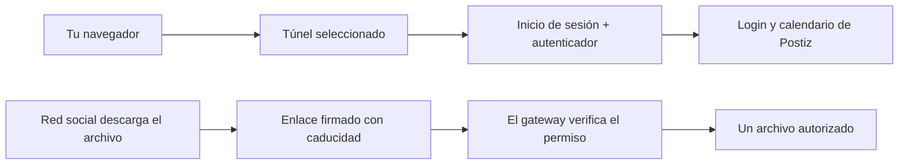

# Guía técnica de PostForge

El desarrollo actual de v2 usa el cliente de escritorio Rust. Las secciones anteriores del controlador del Mac describen el comportamiento de Swift y no implican que esas funciones ya estén en Rust. Consulta Implementación de Rust y Telegram para conocer el alcance actual de la beta.

PostForge controla desde macOS una instalación local de publicación. Prepara planes y borradores. Postiz y Temporal gestionan las publicaciones aprobadas. Evolution y Baileys vinculan la sesión de WhatsApp del operador.

```text
Ventana de publicación ───────┐
WhatsApp → Evolution ─────────┼→ Plan → Vista previa y aprobación
Textos locales con Ollama ────┘              │
                                            ├→ Postiz → Temporal → Redes sociales
                                            └→ Cola de estados aprobados → Evolution
```

## Instala y configura

1. Instala el paquete de PostForge y los requisitos de SETUP.md, incluidos Docker Desktop, Ollama y FFmpeg.
2. Copia .env.example a .env. Configura las credenciales de la base de datos, el secreto JWT, el dominio y token de ngrok y la clave de Evolution. Si trabajas fuera de Ecuador, configura PM_TIMEZONE.
3. Elige acceso local o una puerta de enlace HTTPS con autenticación. Configura las credenciales y URL de retorno de OAuth para la dirección de Postiz y conecta las redes sociales. Consulta los permisos de cada conector en la [guía de configuración de canales](https://github.com/isaacmateosv/postforge/blob/main/docs/reconnect/channel-setup-es.md).
4. Enciende PostForge. Abre **WhatsApp Manager** y escanea el código QR con el teléfono autorizado. Mantén la clave de la API en privado.
5. Ejecuta las verificaciones de solo lectura desde la carpeta del proyecto.

```bash
cd ~/postforge
./postforge.sh doctor
./scripts/recheck.sh --live
```

## Configura Telegram

Crea un bot exclusivo con BotFather. En Terminal, desde la carpeta de PostForge,
ejecuta `python3 v2/telegram_setup.py --language es --heartbeat 0`. Ingresa el
token en el campo oculto y envía `/start` en tu chat privado con el bot cuando
se te indique. Confirma la cuenta, ejecuta `./postforge.sh telegram start` y
envía `/status`. El agente sigue disponible mientras la infraestructura está inactiva; redactar y enviar requiere los servicios correspondientes.
Con `0` no se envían avisos periódicos. Para activarlos, elige entre 5 y 1440
minutos.

## Acceso independiente sin ngrok

Para una instalación local, ejecuta Compose en el Mac, en Linux o en Windows
con Docker Desktop. El panel web de v2 está disponible en el equipo anfitrión.
También puedes abrir Postiz en su puerto local. El README de v2 incluye los
comandos de Compose y el estado de las pruebas por plataforma.

Para entrar desde otros equipos, usa una puerta de enlace HTTPS con autenticación
o una red privada con controles de acceso. Mantén los puertos directos en privado.
Configura primero los usuarios y la autenticación de varios factores de la puerta
de enlace. Luego crea la cuenta de Postiz por esa ruta protegida. Si necesitas
habilitar el registro para crear la cuenta inicial, vuelve a deshabilitarlo al terminar.

Si usas ngrok, protege toda la dirección pública. Si usas un dominio propio,
actualiza la dirección de Postiz y las URL de retorno de los proveedores.
Revisa el README de v2 antes de cambiar una instalación pública.

## Operación diaria

- La ventana del Mac y tu chat contigo en WhatsApp usan el mismo planificador. El texto entre comillas se conserva.
- Los borradores de redes se aprueban en Postiz. Los estados de WhatsApp tienen su propia cola de aprobación explícita.
- Con los servicios apagados se pausa la recepción. Un mensaje de WhatsApp no puede encender el receptor local. Desde el Mac, usa Siri para abrir la ventana de publicación y elige **Encender**.
- Cada hora se revisan la versión pública de PostForge, las imágenes de Docker declaradas y las versiones estables de Evolution. El instalador refresca los servicios activos y conserva sus datos.

## Archivos y retención

- Los videos de WhatsApp de hasta 256 MiB se descargan por flujo al disco. PostForge verifica el tamaño en bytes y el resumen SHA-256.
- Los estados largos de WhatsApp se dividen en partes de hasta 60 segundos después de aprobarlos.
- La limpieza de archivos temporales de WhatsApp se ejecuta cuando el receptor está activo. La retención predeterminada es de 30 días. Se protegen los envíos pendientes, las confirmaciones futuras y los archivos vinculados a publicaciones de Postiz.
- Revisa qué borraría la limpieza general antes de aplicarla. Puedes ajustar la retención en el menú de la barra.

```bash
./postforge.sh retention
./postforge.sh retention --apply
```

## Respalda y recupera

En **Respaldo y traslado**, exporta las credenciales cifradas y el archivo verificado de Postiz. Mantén ese archivo en privado porque contiene tokens de los canales. Restaura en el Mac de destino antes de programar contenido nuevo, verifica los envíos pendientes y vuelve a vincular WhatsApp. La migración excluye las tareas de Temporal y la sesión de WhatsApp. Si configuraste el acceso seguro, la misma contraseña también protege `gateway.enc`. Ese archivo contiene la lista de acceso, los hashes de las contraseñas y el registro de los autenticadores. Guárdalo junto con el respaldo. Después de restaurar, valida el acceso seguro y el túnel antes de exponer Postiz. Los usuarios vuelven a iniciar sesión con su contraseña y los códigos de su autenticador.

Si Postiz queda inaccesible al cambiar el túnel, revisa en el registro si se restauró la configuración anterior. Para recuperar una conexión específica, consulta docs/reconnect en el repositorio. Usa **Abrir registro** en la barra antes de reiniciar o eliminar datos.

```bash
./postforge.sh status
./postforge.sh channels
./postforge.sh maintenance check
```

### Entrega de archivos con el acceso seguro

PostForge genera un enlace firmado para que cada red social descargue el archivo
adjunto. El enlace permite GET y HEAD únicamente para ese archivo y vence 48 horas
después de la hora planificada. Esta ruta permite programar hasta 30 días por
adelantado. Si cambias un borrador a una fecha posterior al vencimiento del enlace
o cambias el dominio público, prepara nuevos borradores antes de aprobarlos.
Quien tenga un enlace vigente puede descargar ese archivo, así que trátalo como
información privada. El panel de Postiz, la API y los archivos sin enlace firmado
siguen requiriendo el inicio de sesión del acceso seguro.

Antes de crear publicaciones, PostForge verifica una descarga de un byte en cada
enlace firmado, incluidas las portadas. Si falla, detiene la creación y muestra
el problema. El verificador autoriza la solicitud y Postiz transmite el archivo
directamente. No se crea otra copia del video. Las reglas de retención vigentes
siguen controlando su eliminación.

Las nuevas configuraciones del acceso seguro crean una clave privada de 32 bytes
para firmar los enlaces. En una instalación anterior, créala una sola vez con
este comando y aplica los archivos actualizados de Compose y Caddy.

    python3 scripts/lib/media_links.py init-key data/gateway/media-signing.key

Mantén la clave privada. Respaldo y traslado la incluye en el archivo cifrado del
acceso seguro. Al restaurar un respaldo anterior, se genera una clave nueva.
Una sesión revocada o vencida en una red social todavía requiere volver a
conectarla desde Postiz.

Si seleccionas historias de Facebook o Instagram y adjuntas un solo video largo,
se preparan clips equilibrados de menos de 60 segundos. Las publicaciones del
feed conservan el video completo. Revisa cada borrador de historia en orden.
La programación directa separa las partes por un minuto. Los clips temporales
se eliminan después de subirlos y sus copias en Postiz siguen las reglas
normales de retención.

## Estado del formulario y configuración avanzada

La revisión y navegación de versiones modifican solo los campos del texto.
La vista nativa reemplaza esa sección y conserva los datos del plan y la posición
de desplazamiento. Editar el pedido o las opciones de los archivos invalida el
plan y limpia sus versiones. La ventana de dos columnas permite crecer al campo
del pedido dentro del espacio disponible y desplazar el plan por separado.

El analizador separa la programación del contenido. Las comillas dobles y los
campos texto/caption conservan la redacción. Una idea sin comillas solicita
generación. Se admiten fechas día/mes de Ecuador, fechas ISO, días de la semana,
AM/PM incluso con espacios como “p. m.” y la zona horaria configurada. Revisa la
fecha y hora resueltas antes de crear borradores. Las fechas u horas inválidas,
pasadas o demasiado próximas producen un error. Para obtener resultados
predecibles, escribe los destinos y la hora antes del texto o la idea.

El modelo local es una configuración avanzada. Instala el modelo de Ollama que
necesites y define LOCAL_LLM_MODEL en el archivo privado .env. OLLAMA_HOST_URL
selecciona el servidor local. El siguiente horneado lee esos valores. El formulario
muestra etiquetas descriptivas y oculta el identificador del modelo. Un modelo
más grande consume más memoria y tarda más en generar. Los modelos se mantienen
fuera del instalador.

La limpieza toma una vista previa de los grupos pendientes en la organización
seleccionada. Al confirmar, vuelve a revisar cada grupo y usa el DELETE de la API
pública de Postiz para ejecutar su cancelación del programador. Conserva los
elementos que cambiaron. Los Estados pendientes de WhatsApp se cancelan con el
bloqueo de la cola; los que ya están enviándose quedan excluidos. Una publicación
externa que ya empezó puede completarse. Se muestran los fallos y elementos
omitidos; un nuevo intento requiere otra vista previa. Los archivos compartidos
por otras publicaciones siguen la retención normal.

Los anuncios sin archivos requieren elegir destinos compatibles en la interfaz
del Mac. La CLI acepta --text-networks facebook,threads,whatsapp sin archivos.
En WhatsApp se usa la confirmación “solo texto aprobado” / “only text approved”.
Facebook y Threads usan publicaciones del feed; WhatsApp usa Estados.
Las historias de Instagram y Facebook en esta app requieren archivos. Las
tarjetas que convierten texto en imagen siguen pendientes. Los botones guiados
de Telegram usan el formulario compartido descrito abajo.

Windows y Linux también cuentan con el nuevo formulario Rust/Tauri descrito
abajo. El panel web existente conserva su modo de solo lectura.


## Implementación de Rust y Telegram

El cliente Rust/Tauri integra su interfaz e invoca el puente local de Python
por entrada/salida estándar. Acepta operaciones conocidas y no abre un servidor
HTTP de comandos. Las credenciales quedan fuera de la interfaz. Python, Docker,
FFmpeg y Ollama para generar textos siguen siendo requisitos. Windows necesita
el iniciador py y tzdata. desktop/README.md describe dependencias y artefactos.

Los registros privados en run/composer-plans conservan los campos revisados,
el desplazamiento horario, las huellas de archivos y una familia de envío.
Las vistas previas vencen después de 24 horas. Todas las versiones del texto
comparten la protección contra repeticiones. Un envío terminado devuelve su
confirmación; uno parcial o incierto queda en needs_review y no se repite
automáticamente. Cambiar archivos requiere otra revisión. La retención incluye
estos registros. La compilación en CI y la aceptación en equipos reales son
verificaciones separadas.

scripts/host_agent.py despacha Estados de WhatsApp aprobados y ejecuta el bot.
Permite start, stop, restart y status. Se detiene de forma cooperativa para que
una operación en curso registre su resultado. Los bloqueos de procesos en Unix
y Windows protegen los datos compartidos. Las imágenes usan sips en Mac y FFmpeg
en otros sistemas. Los Estados se envían invocando Python directamente. El agente
no mantiene un modelo activo mientras espera.

Telegram usa un token local, un propietario numérico privado y la posición
persistida del receptor. Los botones incluyen referencias de conversación y
versión y vencen con el plan. Se ignoran otros usuarios y grupos. Enviar requiere
otra confirmación. Los envíos interrumpidos quedan retenidos para revisar el
calendario. Las consultas son salientes y se conserva el acceso seguro. El
receptor antiguo en Docker se detiene antes de activar el agente local. Un bot
debe tener un solo receptor.

Usa v2/telegram_setup.py localmente con --language es o en y, si deseas,
--heartbeat 15. Rechaza un webhook existente, valida el token, identifica un
/start privado, pide confirmar al propietario y registra comandos. El .env privado es la fuente principal de los ajustes y el token de Telegram;
run/telegram contiene cachés derivadas. La UI de Rust valida y reinicia el agente
al guardar. Los archivos anteriores se incluyen al exportar credenciales cifradas.
Configura por separado el inicio automático del sistema. Un equipo apagado o
suspendido no avisa de su propia caída; hace falta un monitor externo para
detectar la ausencia de avisos de actividad.

Las descargas del bot tienen un límite de 20 MB. Se guardan por bloques y con
verificación de tamaño en data/postiz-uploads/telegram-intake. Las fuentes de
planes terminados o cancelados se eliminan después de guardar su contenido
necesario; las abandonadas siguen la retención. Antes de migrar, detén el agente
anterior, configura el bot en el destino y empieza otra conversación. Una
conversación activa no es un trabajo portátil.

La beta Rust cubre redacción, revisión, envío, limpieza, aprobación de Estados
y la instalación de actualizaciones desde la app: al confirmar, descarga la
versión correspondiente, verifica su SHA-256, reemplaza la app del Mac en su
lugar y la reinicia (en Windows y Linux deja lista la descarga verificada para
un reemplazo manual). Siri, inicio de sesión, notificaciones y desinstalación
siguen en el controlador del Mac. Los ZIP de escritorio del Mac tienen firma ad hoc;
los de Windows carecen de firma de publicación. La firma de producción y las
pruebas de instalación son verificaciones separadas.

## Configuración de Telegram y contrato de migración

Telegram es opcional y propio de cada instalación: un bot dedicado y una cuenta
privada autorizada. Desde la cabecera de Rust se valida el token, se busca y
selecciona la cuenta y se configura idioma, avisos de actividad y activación.
La respuesta de ajustes nunca incluye el token guardado. Las claves del .env
son TELEGRAM_ENABLED, TELEGRAM_BOT_TOKEN, TELEGRAM_BOT_ID, TELEGRAM_BOT_USERNAME,
TELEGRAM_OWNER_ID, TELEGRAM_LANGUAGE, TELEGRAM_HEARTBEAT_MINUTES,
TELEGRAM_TRANSPORT y TELEGRAM_MIGRATION_HOLD. El token es secreto y sigue la
protección de archivos privados y respaldos cifrados del resto de credenciales.
Nunca se incluye en los paquetes públicos.

La exportación incorpora los ajustes anteriores en la copia cifrada del .env
sin cambiar el origen. La importación añade TELEGRAM_MIGRATION_HOLD=true antes
de guardar el archivo restaurado. La migración detiene al agente del destino
antes de reemplazar las credenciales. Se conservan la preferencia de activación
y los ajustes detallados, pero el receptor queda bloqueado hasta activarlo
desde la UI después de detener el equipo anterior. Al cambiar el bot o su
propietario, o activar una migración, se reinician los índices y la conversación
y se omiten los comandos anteriores. Si falla el inicio, se restauran los
ajustes y los archivos previos de conversación. Desactivar no llama a la API.
Una validación fallida no cambia credenciales. El respaldo cifrado requiere
OpenSSL en todos los sistemas operativos.

## Revisión del estudio de escritorio · rc.22

El inicio consulta datos de solo lectura de la organización actual y muestra
registros principales sin publicar. Los contadores incluyen toda la organización;
la lista reciente se limita a 40 elementos. Se actualiza al volver al inicio
y, como máximo, cada 30 segundos mientras tiene el foco. No sigue consultando
con la app oculta. Los indicadores distinguen respuesta de la API, sesión de
WhatsApp y agente de Telegram; no garantizan la vigencia de todos los tokens.

La app encuentra la instalación mediante la configuración guardada y rutas
conocidas. Solo la recuperación avanzada permite seleccionar una carpeta. La
localiza sin moverla para conservar los montajes de Docker.

Los campos revisados incluyen formato de YouTube y fondo del Estado de texto.
Un Short vertical o cuadrado de más de 179 segundos genera una copia aparte,
verificada de 179 segundos, al enviar. La vista previa no codifica ni sube esa
copia. Solo YouTube recibe la variante; se aplican los enlaces firmados y la
retención existentes. Los temporales se eliminan en finally. Los destinos de
historias indican sus segmentos y los registros incluyen part/parts. Editar el
título de YouTube conserva texto y destinos, limita a 100 caracteres y mantiene
el título manual al pedir otra versión del texto. La revisión 2 del flujo exige
volver a hornear los planes antiguos sin enviar; un envío completado devuelve
su recibo guardado sin repetirlo.

El QR de WhatsApp se devuelve como PNG limitado en tamaño solo después de una
solicitud expresa. No incluye credenciales de Evolution ni se guarda en disco.
Una sesión abierta no se recrea. Se consulta la conexión solo con el diálogo
abierto; después de una vinculación nueva se aplica una vez la configuración de
recibos existente. El fondo del Estado de texto se valida como color hexadecimal
y se guarda con el elemento de la cola que requiere aprobación. Los comandos
en grupos de Telegram siguen sin admitirse; añadir el bot a un grupo no concede
permiso para publicar.


## Ventana, bandeja y migración
La ventana Rust se abre centrada y con un ancho cómodo (hasta 1120 píxeles lógicos); aprovecha más altura si el escritorio lo permite. Conserva el acceso a la barra de menús del sistema y puedes maximizarla manualmente. La cabecera y los controles inferiores permanecen visibles; el área de trabajo y los diálogos largos permiten desplazarse. En pantallas de menor altura, el espaciado se vuelve más compacto. Cerrar oculta la ventana; ⌘N (macOS) o Ctrl+N (Windows/Linux) vuelve a abrir el formulario mientras PostForge sea la app activa. El ícono del Dock de macOS también vuelve a mostrar la ventana. Salir en la bandeja cierra el cliente y los servicios de publicación siguen activos.

Usa **Respaldo y traslado** desde la ventana o la bandeja. La exportación crea un archivo `.pfbackup` cifrado y autenticado con las credenciales, la configuración del acceso seguro, los datos de Postiz y los archivos multimedia; además, verifica la restauración en una base temporal. Guarda por separado la contraseña de al menos 12 caracteres: no se puede recuperar. Revisar un respaldo no modifica los datos activos. Para restaurar, revisa el mismo archivo, vuelve a ingresar la contraseña y confirma que el equipo anterior esté detenido. Reemplazar datos existentes requiere marcar una casilla y primero crea un respaldo cifrado de recuperación. Si las credenciales de la base son distintas, necesitas una instalación de destino nueva. Los servicios restaurados quedan detenidos y Telegram permanece en pausa: verifica la URL pública, el acceso seguro, las sesiones de los canales y los horarios antes de iniciar los servicios o activar Telegram. WhatsApp puede necesitar vincularse otra vez.

La bandeja incluye Inicio, Nueva publicación, planes y aprobaciones de WhatsApp, conexiones, respaldos, actualizaciones, ajustes y Ayuda. Acerca de está casi al final, antes de Salir. Un número pequeño junto al ícono monocromático indica tareas activas. La app busca actualizaciones al iniciar y cada seis horas; la consulta manual incluye los componentes de Docker y Evolution. Las consultas incompletas se indican como tales; el cliente solo ofrece archivos ZIP Rust compatibles, no paquetes anteriores.


### Dónde encontrar las acciones en la app

Redacta → Destinos → Revisa y termina permanece en la parte superior. Elige **Generar un texto** si tienes una idea o **Usar mi texto** para conservar tu redacción. Las opciones muestran por separado la selección y el foco del teclado. El pie contiene información de privacidad y, mientras redactas, **Limpiar formulario**. El mantenimiento está en **Ajustes → App y datos**: actualizaciones, **Respaldo y traslado**, y eliminación de borradores o publicaciones en cola. El idioma también está en Ajustes. Puedes actualizar el inicio junto a **Abrir Postiz**. Estas acciones siguen disponibles en la bandeja. La limpieza muestra una vista previa y pide confirmación antes de eliminar algo. El batidor solo se anima mientras se prepara el plan y respeta la preferencia del sistema para reducir movimiento.


### Validación de diálogos y publicaciones de escritorio

El controlador de diálogos oculta los que ya se cerraron, marca como modal solo el diálogo activo y restablece el diálogo anterior al cerrar una confirmación anidada. Ejecuta `node --test desktop/test/dialogs.test.cjs` para comprobar estos estados. La revisión nativa verifica además la accesibilidad real de WebKit y la reapertura con el teclado en macOS. Los flujos publican archivos ZIP Rust para v2; los instaladores Swift anteriores solo se publican con etiquetas v1.


## YouTube: configuración, formatos y reconexión

**YouTube Data API v3** y el mismo cliente OAuth sirven para Shorts y videos normales. No existe un permiso exclusivo para Shorts. Postiz gestiona el inicio de sesión de Google; la aplicación de escritorio no recibe la respuesta OAuth.

## Google Cloud Console

1. Selecciona el proyecto de tu instalación. En **APIs y servicios → Biblioteca**, habilita **YouTube Data API v3** y **YouTube Analytics API**. El conector instalado usa Data para subir videos y Analytics para estadísticas.
2. En **Google Auth Platform → Branding**, configura la identidad de la aplicación. Declara únicamente dominios que controles; no intentes verificar el dominio compartido `ngrok-free.dev`.
3. En **Audience**, elige la audiencia interna o externa que corresponda. Si está en Testing, agrega como usuarios de prueba las cuentas de Google que administran los canales. Con estos permisos, los tokens de actualización de aplicaciones externas en pruebas normalmente caducan en siete días. Pasar a Production está sujeto a las políticas de verificación y de cuentas de Google.
4. En **Clients**, crea o conserva un cliente OAuth de tipo **Web application**. El origen JavaScript debe ser el origen público de Postiz. La URI de redirección debe coincidir exactamente con `https://TU-HOST-PUBLICO/integrations/social/youtube`. Conserva la protección del gateway y conecta desde un navegador que ya haya pasado su autenticación.
5. En **Data Access**, configura los permisos del conector instalado. Todos los siguientes llevan el prefijo `https://www.googleapis.com/auth/`:

   `userinfo.profile`, `userinfo.email`, `youtube`, `youtube.force-ssl`, `youtube.readonly`, `youtube.upload`, `youtubepartner`, `yt-analytics.readonly`.

   Google admite `youtube.upload` para una subida, pero este conector de Postiz verifica los ocho al iniciar sesión. Son requisitos del conector, no los permisos mínimos de una aplicación propia dedicada solo a subir videos. Los permisos amplios pueden requerir verificación adicional.
6. Guarda `YOUTUBE_CLIENT_ID` y `YOUTUBE_CLIENT_SECRET` en el `.env` privado. Ambos deben pertenecer al mismo cliente web. Una API key no reemplaza OAuth. No publiques `.env` ni compartas secretos en reportes.
7. Si cambiaste las credenciales, recrea Postiz mediante el flujo normal de actualización o reinicio de componentes para que reciba el nuevo entorno. Si ya son correctas, conserva ambas y usa **Reconnect channel** en Postiz. Inicia sesión como propietario y elige el canal o la cuenta de marca correspondiente.

Los tokens de actualización se guardan en la base de datos de Postiz, no en `.env`. **Respaldo y migración** incluye ambos de forma cifrada. Después de migrar, revisa el gateway, la dirección pública y la URI OAuth. Cambiar de dominio requiere actualizar los orígenes y redirecciones del cliente; no necesariamente cambiar el secreto.

## Formatos y revisión

- **Automático**: los videos verticales o cuadrados van a Shorts; si superan tres minutos, se prepara una copia de **2:59** para YouTube. Los horizontales conservan su duración y van como videos normales. Los demás destinos mantienen sus propios archivos.
- **Shorts**: usa un archivo vertical o cuadrado. PostForge no recorta automáticamente un video horizontal.
- **Video normal**: usa un archivo horizontal. YouTube clasifica como Shorts los videos verticales o cuadrados que cumplen el límite de tres minutos; un selector o hashtag no cambia esa regla. Para publicar ambos formatos, prepara y revisa versiones separadas.
- El título admite hasta 100 caracteres. La descripción es independiente y no se recorta a ese límite. Revisa o edita el título antes de crear los borradores.
- La descripción termina con la etiqueta configurada para el negocio, además de las etiquetas temáticas. Si está vacía, termina con `#shorts`. No se añade `#Shorts` al título. La etiqueta no determina el formato.
- Revisa el archivo en el reproductor local de Redacta. En Destinos puedes ver la portada subida o el fotograma elegido. Que exista una vista previa no significa que todos los destinos admitan portadas personalizadas: para Shorts, elígela en YouTube.

## Estado de conexión y prueba

Abre **Conexiones** en la cabecera. Se consultan las credenciales guardadas en Postiz, la señal de reconexión, la caducidad real del token y los errores de autenticación. Un inicio de sesión nuevo prevalece sobre errores anteriores. Un token de acceso vencido con token de actualización se muestra pendiente de renovación. Este indicador describe la sesión; no garantiza una publicación, permisos completos ni cuota disponible.

Primero crea un borrador de prueba. Revisa título, descripción y formato; luego programa explícitamente una prueba con la visibilidad deseada. Comprueba su resultado en Postiz y YouTube Studio antes de reintentar el resto. Para subir videos de más de 15 minutos, verifica el canal en YouTube.

## Recuperar publicaciones fallidas

No vuelvas a crear las publicaciones que sí salieron. Con una audiencia grande, cada segmento de un Estado de WhatsApp puede tardar varios minutos: revisa el estado de entrega primero. En Postiz, corrige la causa del error y revisa únicamente las entradas fallidas antes de asignarles una hora futura. Reconectar no reenvía los errores anteriores. Las subidas a la bandeja de TikTok todavía deben completarse en TikTok.

| Error | Qué hacer |
|---|---|
| `401 Invalid Credentials` / refresh token | Reconecta el canal como propietario. Conserva el ID y secreto si son correctos. |
| `redirect_uri_mismatch` | Haz coincidir exactamente la URI pública de redirección del cliente web. |
| Aplicación bloqueada o sin verificar | Revisa usuarios de prueba, verificación y políticas de Workspace. |
| Error de cuota | Revisa las cuotas actuales del proyecto en Google Cloud. |
| El enlace del archivo devuelve HTML, autenticación o error de rangos | Corrige la entrega mediante enlaces firmados por archivo. Conserva el gateway y no hagas pública la biblioteca. |

Fuentes: [subidas y permisos](https://developers.google.com/youtube/data/reference/rest/v3/videos/insert), [clasificación de Shorts](https://support.google.com/youtube/answer/15424877?hl=es), [caducidad OAuth](https://developers.google.com/identity/protocols/oauth2/#expiration), [Google Auth Platform](https://support.google.com/cloud/answer/15544987?hl=es), [videos largos](https://support.google.com/youtube/answer/71673?hl=es), [configuración de Postiz](https://docs.postiz.com/self-host/providers/youtube).

[English guide](youtube.md)


## Acceso público: TryCloudflare y tu propio dominio

PostForge conserva el gateway de autenticación delante de Postiz con cualquier proveedor. La biblioteca de archivos sigue protegida. Las redes reciben enlaces firmados que caducan y permiten descargar únicamente un archivo.



## En la app o la barra de menús

Abre **Ajustes → Acceso público → Configurar red** o **URL pública y túnel** en la barra de menús. **Comprobar acceso** verifica el gateway público por separado de las sesiones de las redes. Que el contenedor esté encendido no garantiza que la URL funcione. Inicio muestra una advertencia si el acceso falla o la URL temporal necesita sincronizarse.

Para cambiar, primero completa o cancela las publicaciones programadas. PostForge guarda una copia privada de recuperación, actualiza el origen de Postiz, el dominio y las cookies del gateway, recrea los servicios afectados, verifica el acceso y el planificador, y actualiza los enlaces de archivos en Postiz. No modifica los textos ni publica o reenvía nada. Si falla, restaura la configuración anterior; un proveedor anterior sin cuota puede seguir sin funcionar después de esa restauración.

## TryCloudflare · temporal

Selecciona **TryCloudflare** y **Aplicar configuración**. No necesitas cuenta de Cloudflare, dominio ni token. **Rotar URL temporal** reinicia el conector para obtener otro dominio. PostForge mantiene ese proceso encendido mientras sincroniza Postiz y el gateway, para no perder enseguida la URL recién generada.

**El dominio cambia al reiniciar el proceso del conector**, incluso al reiniciar Docker o durante ciertas actualizaciones. Entra a los ajustes de red y pulsa **Aplicar configuración** para sincronizar el dominio nuevo detectado. Revisa la advertencia en Inicio antes de publicar. Usa Abrir Postiz en la app o la barra de menús, en lugar de guardar una URL temporal vieja como favorito.

Los Quick Tunnels son para pruebas: no tienen garantía de disponibilidad, admiten hasta 200 solicitudes simultáneas y no soportan Server-Sent Events. PostForge no los presenta como un servicio ilimitado para videos de producción. Esta opción es temporal mientras preparas un dominio estable.

## Tu dominio · túnel de Cloudflare con nombre

1. Añade a Cloudflare un dominio que controles y crea un túnel con nombre desde su panel.
2. Configura el dominio público para dirigirlo a **`http://postforge-gateway:8080`**. El conector participa en la red Docker de PostForge. No lo dirijas directamente a Postiz, no publiques los puertos del gateway o del servicio de identidad y no añadas una autenticación interactiva de Cloudflare Access sobre las rutas de archivos firmados.
3. En PostForge elige **Cloudflare · mi propio dominio**, ingresa el origen HTTPS completo y pega el token en el campo oculto. Aplica y comprueba el acceso. Dejar el token vacío conserva el guardado; el token no se devuelve a la interfaz.
4. Actualiza los orígenes y las redirecciones OAuth que se indican abajo. Inicia sesión de nuevo en el gateway usando el dominio nuevo.

Puedes volver a TryCloudflare sin perder el dominio ni el token guardados. Al regresar al túnel con nombre, reutilizarás esos ajustes. Se conserva ngrok como opción compatible, con su dominio y credenciales privados; su cuenta debe tener ancho de banda disponible.

## Redirecciones OAuth y trabajo existente

Cambiar el dominio no modifica automáticamente las consolas de Google, Meta, Threads o TikTok. Antes de reconectar, añade los orígenes y las redirecciones exactas que muestra la app:

| Proveedor | Ruta de redirección |
|---|---|
| YouTube | `/integrations/social/youtube` |
| Facebook | `/integrations/social/facebook` |
| Instagram mediante Facebook | `/integrations/social/instagram` |
| Instagram Standalone, si lo usas | `/integrations/social/instagram-standalone` |
| Threads | `/integrations/social/threads` |
| TikTok | `/integrations/social/tiktok` |

En Google, actualiza también el origen JavaScript autorizado del cliente web. En Meta, revisa App domains, Website Site URL y la lista de redirecciones del flujo Login correspondiente. En TikTok, cambia la redirección del entorno que usas y la verificación de prefijos de URL que requiera tu modalidad. Las páginas de privacidad y términos alojadas aparte no cambian de dirección. Los tokens actuales pueden seguir vigentes: no desconectes canales que funcionan sin necesidad. Un inicio de sesión nuevo o una reconexión sí necesita redirecciones correctas. Prepara un plan nuevo después de cambiar la URL.

Las publicaciones guardadas conservan su estado; el cambio no las aprueba, programa ni reintenta. Lo publicado sigue en la red social. El navegador debe volver a iniciar sesión en el dominio nuevo. Se conservan las cuentas del gateway y los secretos de los autenticadores.

## Respaldos, migración y recuperación

`PM_TUNNEL_PROVIDER`, `PM_CUSTOM_DOMAIN`, `PM_NGROK_DOMAIN` y el token privado `CLOUDFLARE_TUNNEL_TOKEN` se incluyen en el respaldo cifrado de credenciales. Al restaurar, se regenera el conector de Compose según esos ajustes y los servicios quedan detenidos. No asumas que una URL temporal seguirá funcionando al migrar: inicia el conector del destino, aplica su URL nueva, actualiza las redirecciones y verifica el acceso antes de publicar. Detén primero el equipo de origen. El perfil de dominio propio se conserva aunque uses TryCloudflare temporalmente.

El servicio y contenedor mantienen los identificadores internos `ngrok` y `pm-tunnel` por compatibilidad con el ciclo de vida existente. La imagen y el comando corresponden al proveedor elegido; el nombre no indica que se esté usando ngrok. `docker-compose.override.yml` selecciona el conector. Los secretos permanecen en `.env`; la configuración pública predeterminada solo contiene referencias a variables. Revisa los cambios locales de proveedor antes de incluirlos en un commit.

Si falla un cambio, revisa los originales privados en `run/network-recovery-*`. No los compartas: contienen credenciales. Las comprobaciones no modifican la configuración y usan una caché breve; Comprobar acceso fuerza una revisión nueva. No desactives el gateway para resolver un problema de conectividad.

Fuentes: [Quick Tunnels y sus límites](https://developers.cloudflare.com/tunnel/get-started/quick-tunnels/), [túnel con nombre](https://developers.cloudflare.com/tunnel/get-started/), [configuración OAuth de YouTube](youtube-es.md).


Haz clic en la URL pública actual o en **Copiar enlace** para copiarla. El control cambia brevemente a verde y confirma **Enlace copiado**. Las URL de redirección OAuth también se copian al hacer clic; con el teclado, usa Tab y Enter o Espacio.
