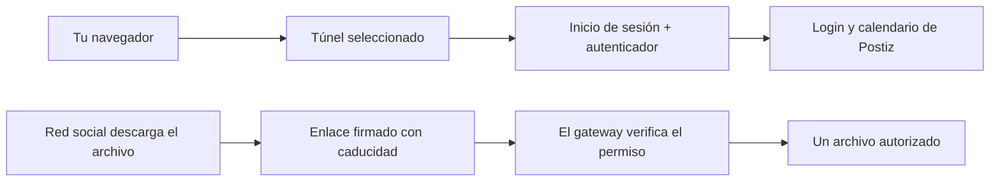

# Acceso público: TryCloudflare y tu propio dominio

PostForge conserva el gateway de autenticación delante de Postiz con cualquier proveedor. La biblioteca de archivos sigue protegida. Las redes reciben enlaces firmados que caducan y permiten descargar únicamente un archivo.

## En la app o la barra de menús

Abre **Ajustes → Acceso público → Configurar red** o **URL pública y túnel** en la barra de menús. **Comprobar acceso** verifica el gateway público por separado de las sesiones de las redes. Que el contenedor esté encendido no garantiza que la URL funcione. Inicio muestra una advertencia si el acceso falla o la URL temporal necesita sincronizarse.

Para cambiar, primero completa o cancela las publicaciones programadas. PostForge guarda una copia privada de recuperación, actualiza el origen de Postiz, el dominio y las cookies del gateway, recrea los servicios afectados, verifica el acceso y el planificador, y actualiza los enlaces de archivos en Postiz. No modifica los textos ni publica o reenvía nada. Si falla, restaura la configuración anterior; un proveedor anterior sin cuota puede seguir sin funcionar después de esa restauración.

## TryCloudflare · temporal

Selecciona **TryCloudflare** y **Aplicar configuración**. No necesitas cuenta de Cloudflare, dominio ni token. **Rotar URL temporal** reinicia el conector para obtener otro dominio. PostForge mantiene ese proceso encendido mientras sincroniza Postiz y el gateway, para no perder enseguida la URL recién generada.

**El dominio cambia al reiniciar el proceso del conector**, incluso al reiniciar Docker o durante ciertas actualizaciones. Entra a los ajustes de red y pulsa **Aplicar configuración** para sincronizar el dominio nuevo detectado. Revisa la advertencia en Inicio antes de publicar. Usa Abrir Postiz en la app o la barra de menús, en lugar de guardar una URL temporal vieja como favorito.

Los Quick Tunnels son para pruebas: no tienen garantía de disponibilidad, admiten hasta 200 solicitudes simultáneas y no soportan Server-Sent Events. PostForge no los presenta como un servicio ilimitado para videos de producción. Esta opción es temporal mientras preparas un dominio estable.

## Tu dominio · túnel de Cloudflare con nombre

1. Añade a Cloudflare un dominio que controles y crea un túnel con nombre desde su panel.
2. Configura el dominio público para dirigirlo a **`http://postforge-gateway:8080`**. El conector participa en la red Docker de PostForge. No lo dirijas directamente a Postiz, no publiques los puertos del gateway o del servicio de identidad y no añadas una autenticación interactiva de Cloudflare Access sobre las rutas de archivos firmados.
3. En PostForge elige **Cloudflare · mi propio dominio**, ingresa el origen HTTPS completo y pega el token en el campo oculto. Aplica y comprueba el acceso. Dejar el token vacío conserva el guardado; el token no se devuelve a la interfaz.
4. Actualiza los orígenes y las redirecciones OAuth que se indican abajo. Inicia sesión de nuevo en el gateway usando el dominio nuevo.

Puedes volver a TryCloudflare sin perder el dominio ni el token guardados. Al regresar al túnel con nombre, reutilizarás esos ajustes. Se conserva ngrok como opción compatible, con su dominio y credenciales privados; su cuenta debe tener ancho de banda disponible.

## Redirecciones OAuth y trabajo existente

Cambiar el dominio no modifica automáticamente las consolas de Google, Meta, Threads o TikTok. Antes de reconectar, añade los orígenes y las redirecciones exactas que muestra la app:

| Proveedor | Ruta de redirección |
|---|---|
| YouTube | `/integrations/social/youtube` |
| Facebook | `/integrations/social/facebook` |
| Instagram mediante Facebook | `/integrations/social/instagram` |
| Instagram Standalone, si lo usas | `/integrations/social/instagram-standalone` |
| Threads | `/integrations/social/threads` |
| TikTok | `/integrations/social/tiktok` |

En Google, actualiza también el origen JavaScript autorizado del cliente web. En Meta, revisa App domains, Website Site URL y la lista de redirecciones del flujo Login correspondiente. En TikTok, cambia la redirección del entorno que usas y la verificación de prefijos de URL que requiera tu modalidad. Las páginas de privacidad y términos alojadas aparte no cambian de dirección. Los tokens actuales pueden seguir vigentes: no desconectes canales que funcionan sin necesidad. Un inicio de sesión nuevo o una reconexión sí necesita redirecciones correctas. Prepara un plan nuevo después de cambiar la URL.

Las publicaciones guardadas conservan su estado; el cambio no las aprueba, programa ni reintenta. Lo publicado sigue en la red social. El navegador debe volver a iniciar sesión en el dominio nuevo. Se conservan las cuentas del gateway y los secretos de los autenticadores.

## Respaldos, migración y recuperación

`PM_TUNNEL_PROVIDER`, `PM_CUSTOM_DOMAIN`, `PM_NGROK_DOMAIN` y el token privado `CLOUDFLARE_TUNNEL_TOKEN` se incluyen en el respaldo cifrado de credenciales. Al restaurar, se regenera el conector de Compose según esos ajustes y los servicios quedan detenidos. No asumas que una URL temporal seguirá funcionando al migrar: inicia el conector del destino, aplica su URL nueva, actualiza las redirecciones y verifica el acceso antes de publicar. Detén primero el equipo de origen. El perfil de dominio propio se conserva aunque uses TryCloudflare temporalmente.

El servicio y contenedor mantienen los identificadores internos `ngrok` y `pm-tunnel` por compatibilidad con el ciclo de vida existente. La imagen y el comando corresponden al proveedor elegido; el nombre no indica que se esté usando ngrok. `docker-compose.override.yml` selecciona el conector. Los secretos permanecen en `.env`; la configuración pública predeterminada solo contiene referencias a variables. Revisa los cambios locales de proveedor antes de incluirlos en un commit.

Si falla un cambio, revisa los originales privados en `run/network-recovery-*`. No los compartas: contienen credenciales. Las comprobaciones no modifican la configuración y usan una caché breve; Comprobar acceso fuerza una revisión nueva. No desactives el gateway para resolver un problema de conectividad.

Fuentes: [Quick Tunnels y sus límites](https://developers.cloudflare.com/tunnel/get-started/quick-tunnels/), [túnel con nombre](https://developers.cloudflare.com/tunnel/get-started/), [configuración OAuth de YouTube](youtube-es.md).
