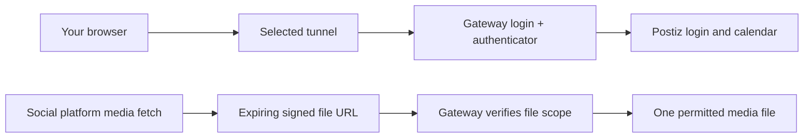

# Public access: TryCloudflare and your own domain

PostForge keeps the authentication gateway in front of Postiz, regardless of tunnel provider. The public uploads library stays protected. Social platforms receive expiring, file-scoped signed links rather than a public library URL.

## In the app or menu bar

Open **Settings → Public access → Configure network**, or **Public URL & Tunnel** in the menu bar. **Check access** verifies the public gateway separately from social-channel login health. A running container alone does not prove the public URL is available. The dashboard warns when the endpoint cannot be reached or the temporary URL needs synchronization.

The switch requires an idle social queue. Finish or cancel scheduled posts first. PostForge preserves a private recovery copy, updates the Postiz origin and gateway hostname/cookie settings, recreates the affected services, verifies the public gateway and scheduler, and rebases Postiz media-library and post-media links. It does not rewrite captions or publish/repost anything. A failed switch restores the previous configuration; an already exhausted old provider can remain unavailable after rollback.

## TryCloudflare · temporary

Choose **TryCloudflare** and **Apply configuration**. No Cloudflare account, domain or tunnel token is required. **Rotate temporary URL** deliberately restarts the connector and requests another hostname. PostForge keeps that connector running while synchronizing Postiz and the gateway so it does not immediately lose the newly generated URL.

**The hostname changes when the connector process restarts**, including after Docker restarts or some updates. Open the network settings and use **Apply configuration** to synchronize a newly detected hostname. Review the dashboard warning before posting. Do not keep a bookmark pointing to an old temporary URL; use Open Postiz from the app or tray.

Quick Tunnels are for testing, have no uptime guarantee, have a 200 in-flight request limit, and do not support Server-Sent Events. PostForge does not describe them as an unlimited production video service. This is a temporary deployment option while you prepare a stable hostname.

## Your own domain · named Cloudflare Tunnel

1. Add a domain you control to Cloudflare and create a named tunnel in its dashboard.
2. Configure the public hostname to forward to **`http://postforge-gateway:8080`**. The connector joins the PostForge Docker network. Do not point it directly at Postiz, publish the gateway/identity-service ports, or add an interactive Cloudflare Access gate over signed media routes.
3. In PostForge select **Cloudflare · my own domain**, enter the full HTTPS origin and paste the tunnel token into the masked field. Apply and verify access. A blank token field retains the saved token; tokens are never returned to the UI.
4. Update the developer-app origins and OAuth callbacks below. Sign in again to the gateway at the new hostname.

You can switch back to TryCloudflare without losing the saved domain or token. Switch to the named-tunnel option again to reuse them. ngrok is retained as a compatibility option using its saved hostname and existing private credentials; its account must have bandwidth available.

## OAuth callbacks and existing work

Changing a hostname cannot automatically edit Google, Meta, Threads or TikTok developer-console settings. Add the exact new origins/redirects displayed in the network window before reconnecting channels:

| Provider | Callback path |
|---|---|
| YouTube | `/integrations/social/youtube` |
| Facebook | `/integrations/social/facebook` |
| Instagram through Facebook | `/integrations/social/instagram` |
| Instagram Standalone, if used | `/integrations/social/instagram-standalone` |
| Threads | `/integrations/social/threads` |
| TikTok | `/integrations/social/tiktok` |

For Google, update the web client's authorized JavaScript origin as well. For Meta, review App domains, Website Site URL and the appropriate Login redirect allowlist. For TikTok, update the redirect in the environment you actually use and any URL-prefix verification required for your posting mode. Hosted privacy/terms pages do not move just because Postiz moves. Existing provider tokens may remain valid; do not disconnect healthy channels unnecessarily. New logins/reconnections require correct callbacks. Prepare a fresh plan after a URL change.

Saved work in Postiz keeps its state; URL changes do not approve, schedule or retry it. A social post already published remains on the platform. A browser session must sign in at the new hostname. Gateway account enrollment and authenticator secrets are preserved.

## Backups, migration and recovery

`PM_TUNNEL_PROVIDER`, `PM_CUSTOM_DOMAIN`, `PM_NGROK_DOMAIN` and the private `CLOUDFLARE_TUNNEL_TOKEN` travel in the encrypted credential backup. Restore regenerates the provider-specific Compose connector from those settings and keeps services stopped. Do not copy a live temporary URL and assume it will survive migration: start the destination connector, apply its new URL, update callbacks and verify access before posting. Stop the source host first. The saved named-domain profile remains available when temporarily using TryCloudflare.

The internal Compose service/container retains its legacy `ngrok` / `pm-tunnel` identifier for lifecycle compatibility; its image and command change to the selected provider. Its name is not proof that ngrok is in use. The generated `docker-compose.override.yml` selects the connector; secret values stay in `.env`, and the public default contains environment references only. Review local provider changes before committing them.

If a switch fails, inspect its private `run/network-recovery-*` originals. Do not share these: they contain credentials. Health checks are read-only and cached briefly; explicit Check access refreshes them. Never bypass gateway authentication to repair connectivity.

Sources: [Cloudflare Quick Tunnels and limitations](https://developers.cloudflare.com/tunnel/get-started/quick-tunnels/), [named-tunnel setup](https://developers.cloudflare.com/tunnel/get-started/), [YouTube OAuth configuration](youtube.md).

Click the current public URL or **Copy link** to copy it. The control briefly turns green and confirms **Link copied**. OAuth callback URLs are clickable copy controls too; use Tab and Enter/Space with the keyboard.
